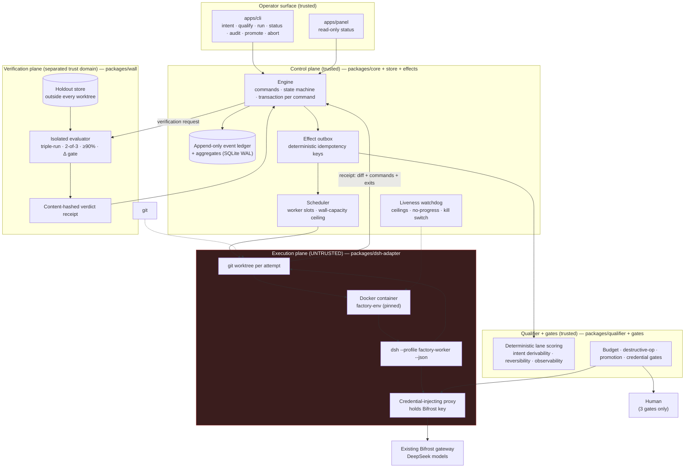

# Architecture — Dark Software Factory on DSH

**Status:** draft pending Phase 5 adversarial debate (Mode A).
**Location:** implemented in this repository (`packages/`, `apps/`, `e2e/`) on branch `feat/dark-factory-dsh`; the prior Path-A factory in `stapled-factory/` is untouched reference.
**Companions:** [`data-map.md`](data-map.md) · [`tech-guide.md`](tech-guide.md) · [`user-stories.md`](user-stories.md) · [`findings.md`](findings.md)
**Research basis:** [`research/dsh-architecture.md`](research/dsh-architecture.md) · [`research/pain-points.md`](research/pain-points.md) · [`research/existing-state.md`](research/existing-state.md)

## 1. Design premise

A dark factory is **not** the harness. It is the surrounding system that makes a harness's output _mergeable without a human reading the diff_. DSH supplies the agent loop (and does it well: one-shot headless runner, durable per-session log, per-session model selection). Everything that makes darkness defensible — the wall, the qualifier, the gates, receipts, blast-radius bounding — is ours to build, and DSH must never be the source of truth for any of it (research D9).

Three laws govern the whole design:

- **L1 — The agent's report is not evidence.** Only a _receipt_ (diff + commands + exit codes + full suite output + artifacts) re-executed by a party without the generator's context may influence a decision. Pain-point R1, sources 1, 13, 16, 30, 31, 32.
- **L2 — Deterministic controls enforce; LLMs advise.** Every ceiling, gate and lane decision is code. Nothing that matters is a request in a prompt. R3/R5, source 34.
- **L3 — Unknown is not pass.** A missing measurement propagates as `unknown` and can never satisfy a gate. Inherited invariant #2 from the prior factory.

## 2. Planes



### 2.1 Control plane — `packages/core`, `packages/store`, `packages/effects`, `packages/contracts`

The only writer of authoritative state. It executes **no agent code** and makes **no model calls** (except the qualifier's optional assessment step, which is advisory only and runs through the same proxy).

- **Command-per-transaction.** Every command is a pure function of `(state, command) → events`, applied in one SQLite transaction. Events are appended; aggregates are derived and materialised in the same transaction.
- **All I/O in activities.** The engine returns effects; `packages/effects` performs them after commit. Model calls, subprocess spawns and network I/O happen **only** in activity handlers. This is the replay-safety rule (R4) implemented without a replay engine.
- **Idempotency keys are hashes of operation inputs** — `sha256(canonicalJson(...))`, never a UUID and never a timestamp taken at retry time. Re-running an effect with the same key is a no-op that returns the stored result.
- **Reconciliation, never redispatch.** On startup the engine finds attempts in `dispatched`/`running` with no terminal event and marks them `ambiguous`, then re-observes them under their original identity (process table, container state, git HEAD, session log). A new attempt requires an explicit operator `retry` or a proven `failed`. Inherited invariant #1.
- **Liveness watchdog** (R3) lives here, not in DSH: per-attempt token ceiling from the session log's usage projection, turn ceiling, wall-clock ceiling, a no-progress detector over NDJSON `status` events plus git tree-hash deltas, and a kill that escalates process-group → container kill → orphan sweep by session id.

### 2.2 Execution plane — `packages/dsh-adapter`

One adapter interface, two implementations (`HeadlessExecutor` v1, `FakeExecutor` for tests; `AcpExecutor` is the documented upgrade path):

```ts
interface Executor {
  start(attempt: AttemptSpec): Promise<AttemptHandle>; // idempotent on attempt.id
  observe(handle: AttemptHandle): Promise<Progress>; // read-only, never mutates work
  terminate(handle: AttemptHandle, why: string): Promise<void>;
  collect(handle: AttemptHandle): Promise<WorkerReceipt>;
}
```

`HeadlessExecutor` per attempt:

1. `git worktree add --detach <attemptDir> <baseRevision>` from a **pristine clone** (never the operator's working tree), inside `~/.factory/work/`.
2. Write a per-run DSH profile patch (`--patch`, applied **last** in the composition order) selecting: provider `bifrost`, worker-tier model, **`sandbox-policy.mode: workspace-write` with `workspaceRoot` pinned to the attempt directory AND `approval.policy: never`** (the shipped base patch couples these — the overlay must decouple them or the worker stalls on an unanswerable approval; verified with `--dump-config`, see `findings.md > D3 correction`), an explicit tool allowlist, `compression: 'none'` for greppable logs, and no MCP servers.
3. Spawn inside the `factory-env` container: `dsh --profile factory-worker --patch <attempt.patch.yml> --json "<task>"`, with `DSH_HOME=~/.factory/dsh-home/worker` (per trust domain — research D5), no host mounts except the attempt directory, egress allowlist to the credential proxy only, no gateway key, no signing key.
4. Parse NDJSON for `status`/`tool_call` progress; outcome = **exit code + `turn_end.reason`**, never text.
5. Capture `git diff --binary <base>...HEAD` **on both exit 0 and exit 1**, plus `git status --porcelain`, the untracked-file list, the session-id tree (`--session-id` value + parent chain from the session header), and the container's command log.
6. Emit `WorkerReceipt` = `{diff, commands[], exit_codes[], suite_output, artifacts[], session_tree[], ceilings_hit[]}` — content-hashed. **The model's prose is stored as `narrative` and is excluded from every decision path** (type-level: decision inputs are `Omit<WorkerReceipt,'narrative'>`).

### 2.3 Verification plane — `packages/wall`

Runs **outside** the worker container, in its own process, with its own `DSH_HOME=~/.factory/dsh-home/evaluator`, its own credentials, and the holdout store at `~/.factory/holdout/` — a path that appears in no worktree, no container mount and no worker prompt.

- **Deterministic re-execution first (R1):** check out the receipt's diff onto a clean base, replay the receipt's `commands[]` in a fresh container, and compare exit codes and full-suite output. Any mismatch → `receipt_unfaithful` (opaque one-liner).
- **Holdout scenarios second (R2):** spec-derived scenarios (HTTP/CLI/assertion based) that the generator never saw. Triple-run, 2-of-3 per scenario, ≥90% aggregate.
- **Δ gate:** `Δ = visible_suite_pass_rate − holdout_pass_rate`, recorded per task class; a class whose Δ is unstable (variance over the last N units) or above threshold cannot be certified `dark`.
- **Opaque feedback:** the generator receives one line — `"<scenario id> failed: <symptom>"` with no scenario text, no expected values, no holdout path.
- **Verdict receipt:** content-hashed, signed with the evaluator key, containing scenario ids + results + Δ + policy version + holdout-store revision. This is the only artifact the promotion gate accepts.
- **Self-adversarial suite (R6):** the wall CI includes (a) a sabotage corpus — changes that pass their visible tests and must be rejected, (b) a "leaky wall" test proving a worktree cannot read the holdout store, (c) a criteria-drift log so a human can re-validate on a schedule.

### 2.4 Qualifier and gates — `packages/qualifier`, `packages/gates`

**Qualifier** = deterministic scoring, **no model anywhere in the decision path** (no advisory call in v1 — see `findings.md > TD9`):

| Signal                       | How measured                                                                                                                                                                                                                                             | Effect                                                                                                                                        |
| ---------------------------- | -------------------------------------------------------------------------------------------------------------------------------------------------------------------------------------------------------------------------------------------------------- | --------------------------------------------------------------------------------------------------------------------------------------------- |
| Intent derivability          | every acceptance criterion must be machine-checkable; a restate-back artifact must exist and share enough vocabulary with the intent (lexical overlap coefficient ≥ 0.5 — it catches "restated a different task", it does **not** measure understanding) | missing or mismatched → `reject`                                                                                                              |
| Reversibility / blast radius | declared touch-paths + operation classes (schema migration, delete, force-push, credential use, network egress)                                                                                                                                          | irreversible → `lit`                                                                                                                          |
| Outcome observability        | the unit must name a non-empty observable oracle (endpoint, CLI, data assertion)                                                                                                                                                                         | missing → **`reject`** (an uncheckable unit must be rewritten, not parked: parking it invites a human to approve something nobody can verify) |
| Task class history           | Δ stability + escape rate for the class                                                                                                                                                                                                                  | unstable → `lit`                                                                                                                              |
| Size                         | diff/file budget from the spec                                                                                                                                                                                                                           | above budget → `lit`                                                                                                                          |
| Budget                       | projected spend ≤ envelope                                                                                                                                                                                                                               | over → `lit`                                                                                                                                  |

Output: `{lane: 'dark' | 'lit' | 'reject', score, reasons: Reason[]}`. A `lit` unit is **parked** in a terminal-for-now `lit_parked` state (recorded in the schema at Phase 9a, per `data-map.md` flag F1) and can only be revived by an operator who widens the mandate.

**Gates** are capabilities. The factory has **exactly three human gates** (constraint in `phased-plan.md > ## Goal`); the destructive-operation boundary is a structural deny, not a fourth human gate — its escalation lands on the credential gate:

| Gate                      | Mechanism                                                                                                                                     | Human required?                                                       |
| ------------------------- | --------------------------------------------------------------------------------------------------------------------------------------------- | --------------------------------------------------------------------- |
| Budget envelope           | `spend_ledger` rows written before dispatch (reservation) and after (actual, or `unknown`); refusal is structural                             | **Yes** to raise an envelope                                          |
| Destructive operation     | normalised post-expansion command classification at the container boundary; the agent cannot call the resolver; the default outcome is `deny` | **No** — structural deny; escalation goes through the credential gate |
| Initial production deploy | `promotion.yaml` requires `verdict.passed && human_signature`; the first promotion of any unit is always signed by a human                    | **Yes, always first**                                                 |
| Credential issuance       | broker mints short-lived, task-scoped, single-repo tokens; the proxy injects them; the worker never sees a secret value                       | **Yes** for privileged classes                                        |

## 3. Components (responsibility · owned data · public interface)

| #   | Component              | Responsibility                                                                                                | Owned data                                                             | Public interface                                                                                                    |
| --- | ---------------------- | ------------------------------------------------------------------------------------------------------------- | ---------------------------------------------------------------------- | ------------------------------------------------------------------------------------------------------------------- |
| C1  | `packages/core`        | Domain engine: command handlers, state machine, reconciliation, watchdog                                      | units, mandates, attempts, claims, leases, verdicts, gate requests     | `Engine` commands (`submitUnit`, `qualifyUnit`, `runUnit`, `observeAttempt`, `abortUnit`, `promoteUnit`, `recover`) |
| C2  | `packages/store`       | SQLite schema, migrations, event ledger, aggregate repos, `atomic()`                                          | the database file, schema version, event ledger rows                   | `Store.open()`, `atomic(fn)`, `read.*`, `ledger.append/read`                                                        |
| C3  | `packages/effects`     | Outbox: enqueue-after-commit, per-kind ordering, backoff, health                                              | effect rows + attempt counters                                         | `enqueue(kind, key, payload)`, `start()`, `drain()`, `health()`                                                     |
| C4  | `packages/contracts`   | Zod schemas + types for unit spec, receipt, verdict, promotion, event                                         | — (no state)                                                           | exported schemas + error codes                                                                                      |
| C5  | `packages/qualifier`   | Deterministic lane scoring + policy revalidation                                                              | policy versions, reason codes                                          | `qualify(unit, policy, history)`, `revalidate(mandate)`                                                             |
| C6  | `packages/gates`       | Budget ledger, destructive-op policy, promotion signing, credential broker                                    | spend entries, gate decisions, issued-token records                    | `authorize(op)`, `reserve(unit)`, `settle(unit, actual\|unknown)`, `signPromotion()`, `mintToken()`                 |
| C7  | `packages/wall`        | Holdout store, deterministic re-execution, scenario runs, Δ metrics, verdict receipts, self-adversarial suite | holdout scenarios, holdout-store revision, verdict receipts, Δ history | `evaluate(request)`, `reexecute(receipt)`, `selfTest()`                                                             |
| C8  | `packages/dsh-adapter` | Worktree + container + DSH process lifecycle, NDJSON supervision, receipt capture                             | attempt directories, session-id tree, process records                  | `Executor` port (see §2.2)                                                                                          |
| C9  | `apps/cli`             | Operator command surface; thin client over C1                                                                 | operator config (paths, no secrets)                                    | `factory <verb>`                                                                                                    |
| C10 | `apps/panel`           | Read-only status page, loopback + token                                                                       | none                                                                   | `GET /` (HTML), `GET /api/status`                                                                                   |

## 4. API surface

Two surfaces: the **in-process typed API** (used by CLI/panel/tests) and the **local HTTP API** (panel + future Source adapters). Files are also an interface: the unit spec in, receipts/verdicts/promotions out.

| Operation                           | Shape                                        | Auth                        | Idempotency                                                                                           | Error semantics                                                             |
| ----------------------------------- | -------------------------------------------- | --------------------------- | ----------------------------------------------------------------------------------------------------- | --------------------------------------------------------------------------- |
| `submitUnit(spec)`                  | `UnitSpec → {unitId, mandateId}`             | operator (local)            | key = `sha256(canonical spec)` — same spec twice = same unit                                          | `SPEC_INVALID` (schema), `DUPLICATE_UNIT` (same key, different intent hash) |
| `qualifyUnit(unitId)`               | `→ LaneDecision`                             | operator                    | key = `(unitId, policyVersion)` — re-qualify only on policy change                                    | `UNIT_NOT_FOUND`, `MANDATE_EXPIRED`                                         |
| `runUnit(unitId)`                   | `→ {attemptId}`                              | operator                    | key = `sha256(unitId, attemptNo, mandateHash)`                                                        | `LANE_NOT_DARK`, `LEASE_HELD`, `BUDGET_EXCEEDED`, `GATE_REQUIRED`           |
| `observeAttempt(attemptId)`         | `→ AttemptView` (read-only)                  | operator                    | naturally idempotent                                                                                  | `ATTEMPT_NOT_FOUND`                                                         |
| `recordReceipt(attemptId, receipt)` | `→ {receiptId}`                              | adapter (in-process)        | key = `sha256(attemptId, receipt.contentHash)` — different hash = `RECEIPT_CONFLICT`, never overwrite | `ATTEMPT_AMBIGUOUS`, `RECEIPT_CONFLICT`                                     |
| `verifyUnit(unitId)`                | `→ {verdictId}`                              | engine (auto after receipt) | key = `sha256(unitId, receiptId, holdoutRevision)`                                                    | `WALL_UNAVAILABLE` (→ `unknown`, not pass)                                  |
| `promoteUnit(unitId, sig)`          | `→ Promotion`                                | **human signature**         | key = `sha256(unitId, verdictId)`                                                                     | `VERDICT_MISSING`, `VERDICT_STALE`, `PROMOTION_UNSIGNED`                    |
| `abortUnit(unitId, reason)`         | `→ Unit`                                     | operator                    | idempotent                                                                                            | `UNIT_ALREADY_TERMINAL`                                                     |
| `recover()`                         | `→ ReconciliationReport`                     | operator / startup          | safe to re-run                                                                                        | —                                                                           |
| `GET /api/status`                   | `→ {units, waitingOnPerson, health, budget}` | loopback token              | —                                                                                                     | 401 without token                                                           |

**Failure philosophy:** every operation is fail-closed. An ambiguous result is _never_ retried implicitly; it is observed. A wall that cannot run yields `unknown`, and `unknown` cannot promote.

## 5. Data ownership

Every entity in [`data-map.md`](data-map.md) has exactly one owner:

| Entity                                                      | Owner                         | Notes                                                       |
| ----------------------------------------------------------- | ----------------------------- | ----------------------------------------------------------- |
| `Unit`, `Mandate`                                           | C1 core                       | immutable after creation except terminal state              |
| `LaneDecision`                                              | C5 qualifier (written via C1) | carries `policyVersion`                                     |
| `Claim`, `Lease`, `Attempt`, `UnitEvent`                    | C1 core / C2 store            | ledger is append-only                                       |
| `WorkerReceipt`                                             | C1 core (produced by C8)      | content-hashed, immutable                                   |
| `Verdict`, `HoldoutScenario`, `WallRevision`, `DeltaSample` | C7 wall                       | the core stores only ids + hashes                           |
| `GateDecision`, `SpendEntry`, `IssuedToken`                 | C6 gates                      |                                                             |
| `Promotion`                                                 | C1 core (signed by C6)        | requires verdict + human signature                          |
| `SessionTree`                                               | C8 adapter (indexed by C2)    | session logs stay in DSH's own store; we index ids + hashes |
| `Effect`                                                    | C3 effects                    |                                                             |

## 6. Integrations

| Integration                           | Auth                                                                                                                                                                  | Rate/limit                                                                                    | Failure handling                                                                                                     |
| ------------------------------------- | --------------------------------------------------------------------------------------------------------------------------------------------------------------------- | --------------------------------------------------------------------------------------------- | -------------------------------------------------------------------------------------------------------------------- |
| **Bifrost gateway** (DeepSeek models) | `BIFROST_API_KEY` held **only** by the credential proxy; workers receive a scoped proxy token                                                                         | DSH `retryPolicy.maxRetries` capped; `always` mode forbidden                                  | provider/network failure → attempt `failed-transient` (retried at most 3×, then `unknown`); never counted as success |
| **`dsh` binary**                      | local process; **not on `PATH`** — resolved as `--dsh-bin` → `FACTORY_DSH_BIN` → `/Applications/DeepSeek Harness.app/Contents/Resources/runtime/cli/bin/dsh` → `PATH` | one process per attempt; version asserted at startup against a pinned constant (`0.2.1-rc.3`) | version mismatch → refuse to start (`DSH_VERSION_MISMATCH`), not a warning                                           |
| **Docker daemon**                     | local socket                                                                                                                                                          | `factory-env` image pinned by digest                                                          | daemon unreachable → `WALL_UNAVAILABLE`/`EXECUTOR_UNAVAILABLE`, fail closed                                          |
| **git**                               | local; worktree only                                                                                                                                                  | one worktree per attempt                                                                      | dirty/pristine mismatch → abort attempt before dispatch                                                              |
| **Operator signing key**              | file reference (path only in config)                                                                                                                                  | —                                                                                             | missing key → promo gate stays closed                                                                                |
| **GitHub**                            | _OUT of scope v1_ — promotion emits a patch + PR body draft, never pushes                                                                                             | —                                                                                             | —                                                                                                                    |

## 7. Infrastructure

- **Topology:** single operator host. One control-plane process, one wall process, N ephemeral worker containers, one credential proxy.
- **Paths:** state `~/.factory/state/factory.db`; worktrees `~/.factory/work/<unit>/`; holdouts `~/.factory/holdout/`; DSH homes `~/.factory/dsh-home/{worker,evaluator}/`; artifacts `~/.factory/artifacts/<unit>/`.
- **Environments:** `dev` (FakeExecutor, no Docker, no model), `docker` (real headless DSH, opt-in), `dogfood` (fixture repo, full loop).
- **Runtime:** Node 22.23.3 today (declared window `>=22.12 <27`); DSH's own 0.2.2 line requires ≥24.9, so a DSH upgrade is gated on a Node upgrade (`scripts/preflight.sh` warns instead of silently passing).
- **Persistence:** SQLite WAL, `synchronous=FULL` (WAL `NORMAL` explicitly gives up commit durability), `busy_timeout=5000` (the default is 0 → instant `SQLITE_BUSY`), `foreign_keys=ON`, single-writer process (file lock at startup). Backup = checkpoint + file copy + `PRAGMA integrity_check`; `node:sqlite`'s `backup()` is unavailable on Node 22, and Litestream is deliberately out of v1 (it adds another loss window).
- **Egress:** the worker container has **no route except the credential proxy**; the proxy is the only component that can reach Bifrost. This is the control that DSH's same-world sandbox cannot provide (kickoff finding: the missing control is egress, not filesystem scope). Upgrade path: Apple Containerization (`sandboxy` pattern — microVM per session + host-side HTTP CONNECT allowlist) on this macOS 26 / Apple-silicon host.
- **Secrets:** `.env` gitignored; broker-minted tokens in worker env only; the Bifrost key never leaves the proxy; the evaluator key never enters the worker; a missing secret degrades to `unknown`, never to `pass`.
- **Trust zones:** operator + control plane + wall + proxy = trusted; worker container + worktree + DSH session = untrusted. The DSH sandbox is explicitly **not** the boundary (C8).

## 8. Non-functional requirements

| NFR           | Target                                                                        | How verified                                      |
| ------------- | ----------------------------------------------------------------------------- | ------------------------------------------------- |
| Durability    | kill -9 at any point → restart reconciles; zero duplicate side effects        | property test over the effect ledger + chaos test |
| Idempotency   | replaying any command/effect yields the identical stored result               | unit tests per command + ledger replay test       |
| Throughput    | wall-capacity-bound; ≥1 dark unit end-to-end in dogfood                       | dogfood run timing recorded                       |
| Latency       | control-plane commands < 50 ms p95 excluding I/O activities                   | benchmark in test suite                           |
| Observability | every decision traceable to `(event, receipt, verdict, policyVersion)`        | `factory audit <unit>` output                     |
| Cost          | per-unit envelope default $2 estimated; `unknown` propagates                  | spend ledger + `factory status`                   |
| Security      | worker cannot read holdouts, gateway key, signing key, or the operator's home | leak tests in wall self-suite + container tests   |
| Availability  | single-operator; no HA; documented recovery runbook                           | recovery test                                     |

## 9. Failure domains and blast-radius analysis (top 3 risks)

1. **The wall approves a bad change.** Layered: deterministic re-execution _before_ scenario scoring, 2-of-3 triple-run, ≥90% aggregate, Δ gate, adversarial sabotage corpus, scheduled human re-validation, and escape-rate audit on shipped units. Residual risk accepted and stated; the claim is "independent + deterministic + adversarially tested + audited", never "safe".
2. **An ambiguous attempt is duplicated.** Prevented by claim/lease fencing + attempt identity preservation + hash-based idempotency keys; reconciliation is read-only and cannot dispatch. Residual: a container killed mid-git-push to a remote — v1 has no remote write, so the blast radius is local.
3. **Spend runaway.** Ceilings are harness-owned (token, turn, wall-clock), reservations precede dispatch, `unknown` blocks promotion, and the kill switch reaches process groups and orphans. Residual: Bifrost pricing differs from our table — recorded as an estimate, flagged `estimated: true`.

## 10. Alternatives considered and rejected

| Alternative                                        | Why rejected                                                                                                                                                                               | Revisit when                                                                                          |
| -------------------------------------------------- | ------------------------------------------------------------------------------------------------------------------------------------------------------------------------------------------ | ----------------------------------------------------------------------------------------------------- |
| **In-process DSH bundle** (the prototype's shape)  | Couples to DSH internal service APIs, one failure domain for all tenants, no isolation between control plane and worker, and it mutates process-wide state (PATH, git config)              | Never for the worker; possibly for an in-DSH operator panel                                           |
| **ACP worker protocol** (`dsh --profile acp`)      | Strongest seam (model selection + programmatic permission answers + resume), but v1 does not need per-session model switching and headless gives crash isolation for free                  | When workers become long-lived pools, or when `ask`-mode escalation must be answered programmatically |
| **Temporal / Restate as the outer durable engine** | Ops burden (server + DB + worker fleet) for a single-operator factory; our ledger+outbox satisfies replay-safety with "one box". The prior repo's Restate spine also never closed the loop | At multi-operator or multi-machine scale                                                              |
| **Postgres**                                       | SQLite WAL is sufficient for one writer and one host; the ledger is portable                                                                                                               | Multi-host or >50 concurrent attempts                                                                 |
| **Reuse the Python wall from `stapled-factory/`**  | Two toolchains, and the existing wall is deliberately unwired; its _design_ is what mattered                                                                                               | If a Python-based scenario library becomes valuable                                                   |
| **Keep OpenHands as the worker**                   | Directly contradicts the request                                                                                                                                                           | —                                                                                                     |
| **Trusting DSH's session log as the run ledger**   | It is per-session, lossy in `--json`, and DSH promises breaking changes (D7/D8/D11)                                                                                                        | Never                                                                                                 |

## 11. Debate Outcomes

Mode A debate run 2026-11-01 over this document: five personas (Principal Systems Architect, Principal Application Security Architect, Distinguished Engineer, Director of Quality Engineering, Senior Penetration Tester), 19 agent turns — research briefs → evidence ledger → position papers → disagreement brief → one round → synthesis.

**Artifacts:** [`consensus-plan.md`](consensus-plan.md) (the amended positions, section by section), [`evidence-ledger.md`](evidence-ledger.md) (every claim with its source), [`debate-transcript.md`](debate-transcript.md) (who argued what, and where they moved).

**Evidence grade: ADEQUATE. Consensus: not reached** — recorded rather than smoothed over, because the disagreement is substantive and empirical, not stylistic. Twelve items were resolved with an amendment; four are escalated to human decision.

### What the debate changed

| #   | Amendment                                                                                                                                                                                                                                                                                                                                | Where          |
| --- | ---------------------------------------------------------------------------------------------------------------------------------------------------------------------------------------------------------------------------------------------------------------------------------------------------------------------------------------- | -------------- |
| A1  | The premise stops implying "the test suite is the only oversight surface" is _solvable_; it claims only that we never rely on the generator's own suite                                                                                                                                                                                  | §1             |
| A2  | At-most-once for external effects needs **intent/outcome effect rows** and an `adopt(attemptId)` reconciliation path, never a timer; a fencing token becomes a required parameter on every mutating command                                                                                                                              | §2.1, §2.2, §4 |
| A3  | The **worker container contract**: a self-contained clone at the identical absolute path (a linked worktree's `.git` is an absolute host path and cannot run git inside a single-mount container), a per-attempt `DSH_HOME` volume, `docker network create --internal` with exactly two members, and a blocking negative-egress test     | §2.2, §6, §7   |
| A4  | The **holdout-run container contract**: fresh container from the same pinned image digest, non-root, read-only root, `--internal`, no `~/.factory` mount, scenario driver _outside_ the candidate holding the expectations                                                                                                               | §2.3           |
| A5  | A **seventh deterministic signal — `security_relevance`**: path/content classifier over declared touch-paths at qualify and over the actual diff at receipt; a security-relevant change is `lit` even when behaviour-preserving                                                                                                          | §2.4           |
| A6  | The **wall owns the oracle**: it applies the candidate source, checks out the base test root, runs its own pinned runner and reads a machine-readable summary — never the agent's `suite_output`; any diff touching the test root, a manifest, lockfile, test config or CI script is `lit`; `commands[]` is demoted to forensic          | §2.3, §3       |
| A7  | **Spend authority moves to the credential proxy** (pre-forward caps on body bytes, output tokens, request count, keyed to the minted per-attempt token, hard refusal, signed usage record); the session-log projection is demoted to audit                                                                                               | §2.4, §7       |
| A8  | **No pre-execution destructive-command intercept exists.** The control is the container's capability/mount set; post-hoc classification is advisory and a destructive-class command yields `unknown` — not a "recorded approval", which would be a fourth gate                                                                           | §2.4           |
| A9  | "DB vs holdout" is renamed to what it is (independent copies); quarantine extends to `holdout/` and `manifest.json`; §9 states that **container escape is full compromise**; the off-host anchor is deferred rather than claimed                                                                                                         | §5, §9         |
| A10 | **Δ provenance**: Δ is measured by the wall from its own re-executed run; an errored scenario yields `unknown` with no Δ sample; a class with too few samples is _not certifiable_ even when the unit verifies, and every promotion in that class is human-signed                                                                        | §2.3, §8       |
| A11 | **Receipt identity** includes `{unitId, attemptId, baseRevision}` so a retried attempt cannot inherit its predecessor's evidence row; the content hash becomes a dedup index                                                                                                                                                             | §5             |
| A12 | **The evaluator signing key** lives outside `~/.factory` under the second uid, its public key ships with the wall, and the leak test asserts the real path                                                                                                                                                                               | §7, §8         |
| A13 | The **worker's `DSH_HOME` survives the container** as a per-attempt named volume seeded read-only and read out after receipt capture — which also stops attempt N from configuring attempt N+1                                                                                                                                           | §2.2           |
| A14 | **Statistical honesty**: the "≥90 % aggregate" rule is retired as a _certification authority_ — at the plan's own m it is unanimity wearing a percentage (α ≈ 0.687 at m = 6), and at large m it is a lottery. Replaced by flakiness damping (per-scenario 2-of-3) **plus** the explicit statement that v1 certifies no pass rate at all | §2.3, §8, §9   |

Two amendments were applied to code that already existed when the debate returned, and are worth naming because they changed shipped behaviour: **A5** (the seventh signal is now in the contract, not just this document) and **A14** (the wall's triple-run is flake damping; no aggregate threshold is used to certify).

### NEEDS_HUMAN_DECISION

| #       | Decision                                                                                                                                    | Why the debate could not settle it                                                                                                                                                                                                                                                                                                                                   | Blocks                          |
| ------- | ------------------------------------------------------------------------------------------------------------------------------------------- | -------------------------------------------------------------------------------------------------------------------------------------------------------------------------------------------------------------------------------------------------------------------------------------------------------------------------------------------------------------------- | ------------------------------- |
| **ND1** | **The certification operating point** — trial unit, m, k, per-scenario quorum, with published α and β                                       | The two targets are jointly infeasible under per-scenario 2-of-3 unanimity (α ≤ 0.05 needs m ≥ 47.8; β ≤ 0.10 needs m ≤ 39.8): one target must move, and which error matters more is a value choice. It also needs two _measured_ facts — wall p50/p95 per verdict on this host and the intra-cluster correlation ρ across a scenario's three runs                   | 9c acceptance                   |
| **ND2** | **Verdict store placement, whether a second OS uid ships in v1**, and therefore the wall's process topology                                 | The split store only helps against a compromised core if the second uid is a real boundary, and whether macOS container-uid separation actually denies access to a bind-mounted host file (or virtiofs makes it cosmetic) is **unverified** — the decisive canary test has not run. A split store needs an IPC endpoint and launchd service the plan does not budget | 9a (verdict table), 9c topology |
| **ND3** | **Proxy metering semantics** — what the proxy counts, where the signed usage record lands, and the reconciliation tolerance against Bifrost | Only the _authority_ moved; turning an estimated envelope into an enforced cap needs a measurement the plan does not have                                                                                                                                                                                                                                            | the proof of the cost NFR       |
| **ND4** | **Off-host anchor scope** for v1.1                                                                                                          | A local watermark cannot detect the coordinated rollback it exists for; signing every watermark exposes the human key to the writer                                                                                                                                                                                                                                  | v1.1 only                       |

### What we must stop claiming

- Do not claim the ceiling **enforces** spend until the proxy meters (ND3).
- Do not claim a **certification** pass rate (ND1, A14).
- Do not claim the wall makes a change **safe**: the honest claim is independent, deterministic where possible, adversarially tested against itself, human-audited on a schedule.
- Do not claim the ledger plus the holdout is **two failure domains**; it is two independent copies, and a container escape is full compromise.
