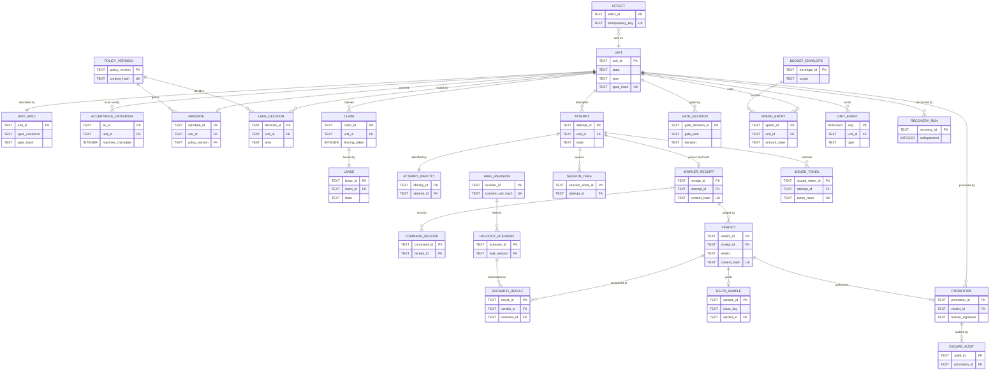
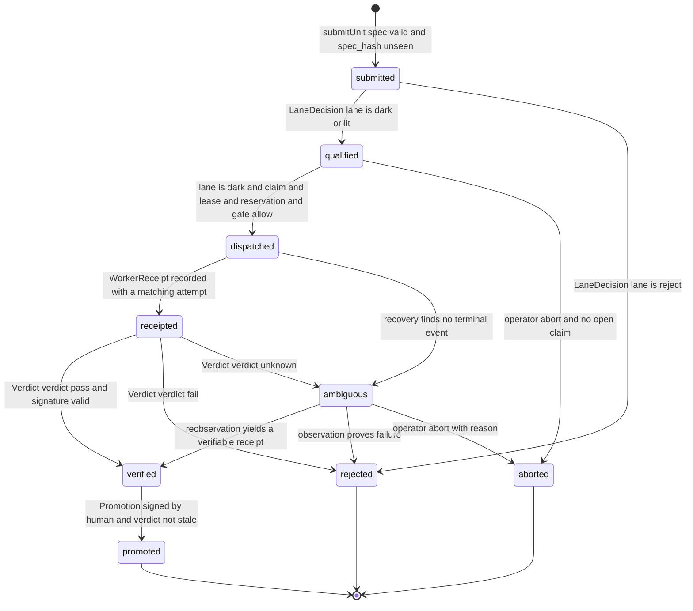
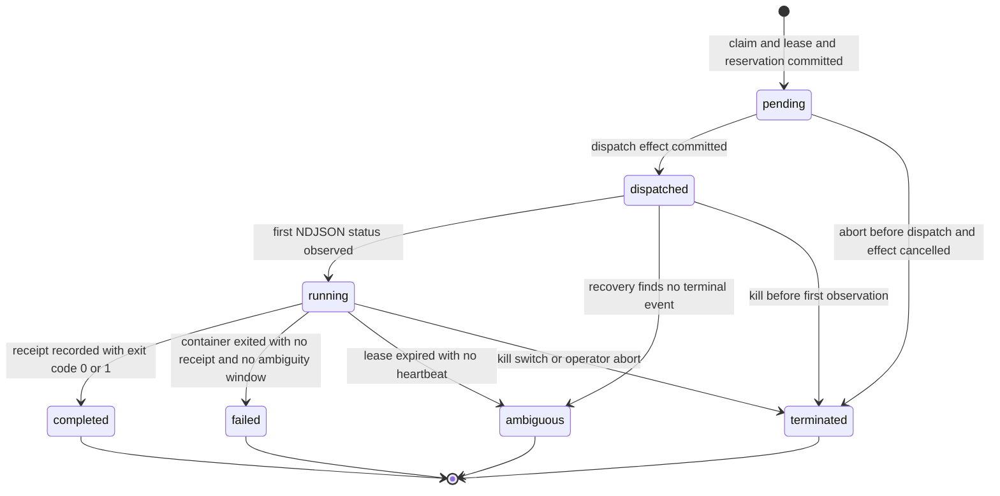
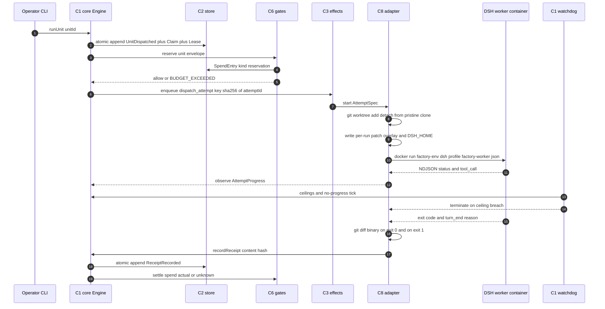
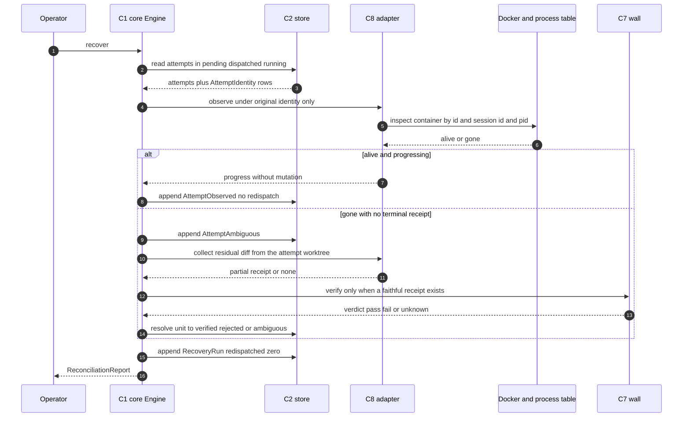

# Data Map — Dark Software Factory on DSH

**Status:** draft (Phase 3). Pairs with [`architecture.md`](architecture.md) (authoritative design), [`user-stories.md`](user-stories.md), [`phased-plan.md`](phased-plan.md), [`findings.md`](findings.md).
**Rule of construction:** every entity below has exactly one owning component from `architecture.md` §3 (C1–C10). Where `architecture.md` §5 names an owner, that owner is reproduced verbatim here; where an entity is implied but unnamed there, the owner is derived from the component that performs the write, and the derivation is stated in the entity's note.

---

## 1. Storage overview

### 1.1 What is stored where

| Store                   | Location                                                                                                                   | Contents                                                                                                 | Writer                                                                   | Mutability                                                                                             |
| ----------------------- | -------------------------------------------------------------------------------------------------------------------------- | -------------------------------------------------------------------------------------------------------- | ------------------------------------------------------------------------ | ------------------------------------------------------------------------------------------------------ |
| **Ledger + aggregates** | `~/.factory/state/factory.db` (+ `-wal`, `-shm`)                                                                           | all 28 entities in §2                                                                                    | C1 `packages/core` via C2 `packages/store` — **one process, one writer** | `unit_event` and the other ledger tables are append-only; aggregates are projections rebuilt by replay |
| Writer lock             | `~/.factory/state/factory.db.lock`                                                                                         | advisory exclusive lock + pid + boot id                                                                  | C2                                                                       | replaced on start, never deleted on crash                                                              |
| Pristine clone          | `~/.factory/work/_pristine.git`                                                                                            | bare clone of the target repo; the **only** source of attempt worktrees                                  | C8 `packages/dsh-adapter`                                                | refs updated by `fetch` only; no worker ever writes here                                               |
| Attempt worktrees       | `~/.factory/work/<unitId>/<attemptNo>/`                                                                                    | `git worktree add --detach` per attempt                                                                  | C8                                                                       | untrusted, disposable after receipt                                                                    |
| Holdout store           | `~/.factory/holdout/scenarios/<classKey>/<scenarioId>.json`, `~/.factory/holdout/revisions/<wallRevision>/manifest.sha256` | scenario bodies + revision manifests; **outside every worktree and every container mount**               | C7 `packages/wall`                                                       | append-only; a revision is frozen once `WallRevision` is written                                       |
| Wall signing key        | `~/.factory/holdout/evaluator.key` (mode `0600`), `evaluator.pub`                                                          | Ed25519 keypair for verdict receipts                                                                     | C7                                                                       | key never rotates without a new `WallRevision`                                                         |
| DSH homes               | `~/.factory/dsh-home/worker/`, `~/.factory/dsh-home/evaluator/`                                                            | `cordis.patch.yml`, `sessions/session.v4.jsonl.zstd`, logs — one home **per trust domain** (research D5) | DSH itself; C8 indexes ids                                               | append-only session logs; never the source of truth                                                    |
| Artifacts               | `~/.factory/artifacts/<unitId>/<attemptNo>/{receipt.json,suite.log,diff.patch}`; cold tier `~/.factory/artifacts/archive/` | receipt payloads, full suite output, patches                                                             | C1 on commit; C2 offloads                                                | immutable once written                                                                                 |
| Backups                 | `~/.factory/state/backups/<utc-iso>/factory.db` + `manifest.json`                                                          | snapshot + hash manifest                                                                                 | operator runbook                                                         | immutable                                                                                              |
| Quarantine              | `~/.factory/quarantine/<utc-iso>/`                                                                                         | moved-aside corrupt/ambiguous stores                                                                     | operator runbook                                                         | never reset, never merged back                                                                         |

### 1.2 Why "one box" is sufficient

The factory is **wall-capacity-bound, not agent-capacity-bound** (architecture §2.1, R7 "restraint"). Concretely: 3 worker slots + 1 human-priority slot, and the wall runs 6 scenarios × 3 runs per verdict. At the design point that is **≤ 4 concurrent attempts**, **≤ 1 receipt committing per 30 s**, and a sustained write rate of **~5 events/s peak / ~0.2 events/s mean**. SQLite in WAL mode with `synchronous=NORMAL` sustains thousands of small committed transactions per second on this host; the factory uses two orders of magnitude less. There is one operator, one host, one control-plane process (C6, single-machine constraint in `phased-plan.md`).

The properties that would normally force a server database are supplied by construction instead:

- **Serialisability** — a single writer process means no write-write conflict exists. Every command is one transaction (`Store.atomic()`), so `(state, command) → events` is applied atomically and no invariant is observable-torn.
- **Durability** — WAL + `synchronous=FULL` (mandatory per `tech-guide.md` §10 — WAL `NORMAL` gives up commit durability) survives process kill (only OS/power loss can lose the tail, and the tail is a re-derivable aggregate, never a decision). The `kill -9` property test is in §6 I7 and `user-stories.md` US-E5-04.
- **Ordering** — `unit_event.seq` is an `INTEGER PRIMARY KEY AUTOINCREMENT`, monotonic and gap-observable; `claim.fencing_token` is monotonic per unit. Fencing, not a queue server, provides at-most-once dispatch.
- **Replay-safety** — the ledger is the authority: replaying `unit_event` from `seq = 1` through the same command handlers must reproduce byte-identical aggregate rows. This is executable (`factory store verify --replay`) and is also the Postgres cutover gate.

**The migration path to Postgres** (trigger: multi-host, or > 50 concurrent attempts — `architecture.md` §10):

1. **Nothing about the data model changes.** Table names, column names, canonical-JSON hashes and the event vocabulary are storage-neutral because every hash is over canonical JSON (RFC 8785), never over storage bytes. The ledger tables stay insert-only.
2. **Mechanical type map:** `TEXT` → `text`, `INTEGER` → `bigint`, `REAL` → `double precision`, `BLOB` → `bytea`, `INTEGER PRIMARY KEY AUTOINCREMENT` → `bigserial`, partial unique indexes → identical `CREATE UNIQUE INDEX … WHERE`, append-only triggers → identical trigger bodies (Postgres syntax differs only in `RAISE`).
3. **The three real changes:** (a) single-writer becomes `SERIALIZABLE` transactions plus `SELECT … FOR UPDATE` on the `unit` row; (b) the in-process outbox poll becomes `SELECT … FOR UPDATE SKIP LOCKED` on `effect`; (c) `delta_sample`/`spend_entry` rollups move to materialised views refreshed on commit.
4. **Cutover gate:** the migration tool must prove `replay(ledger_dump) == aggregate_hash_manifest` on the Postgres target before the SQLite file is demoted to read-only archive. If the hashes differ, the cutover is aborted and the SQLite file remains authoritative — a failed migration is never a data-loss event.

`phased-plan.md` puts this out of v1 scope; the data model is written so that the option survives.

---

## 2. Entities

### 2.0 Summary

| Entity                | Owner                         | Mutability                          | PK                 | Phase |
| --------------------- | ----------------------------- | ----------------------------------- | ------------------ | ----- |
| `Unit`                | C1 core                       | mutable (guarded state only)        | `unit_id`          | 9a    |
| `UnitSpec`            | C1 core                       | append-only                         | `unit_id`          | 9a    |
| `AcceptanceCriterion` | C1 core                       | append-only                         | `ac_id`            | 9a    |
| `Mandate`             | C1 core                       | immutable (revoke only)             | `mandate_id`       | 9a    |
| `LaneDecision`        | C5 qualifier (written via C1) | append-only                         | `decision_id`      | 9d    |
| `PolicyVersion`       | C5 qualifier                  | immutable                           | `policy_version`   | 9d    |
| `Claim`               | C1 core                       | mutable (release only)              | `claim_id`         | 9a    |
| `Lease`               | C1 core                       | mutable (state/heartbeat)           | `lease_id`         | 9a    |
| `Attempt`             | C1 core                       | mutable (state only)                | `attempt_id`       | 9a    |
| `AttemptIdentity`     | C1 core (produced by C8)      | immutable                           | `identity_id`      | 9b    |
| `UnitEvent`           | C2 store (typed by C1)        | append-only                         | `seq`              | 9a    |
| `WorkerReceipt`       | C1 core (produced by C8)      | immutable                           | `receipt_id`       | 9b    |
| `CommandRecord`       | C8 adapter (indexed by C2)    | append-only                         | `command_id`       | 9b    |
| `SessionTree`         | C8 adapter (indexed by C2)    | append-only                         | `session_node_id`  | 9b    |
| `Verdict`             | C7 wall                       | immutable                           | `verdict_id`       | 9c    |
| `ScenarioResult`      | C7 wall                       | append-only                         | `result_id`        | 9c    |
| `HoldoutScenario`     | C7 wall                       | append-only (retire only)           | `scenario_id`      | 9c    |
| `WallRevision`        | C7 wall                       | mutable (human revalidation fields) | `revision_id`      | 9c    |
| `DeltaSample`         | C7 wall                       | append-only                         | `sample_id`        | 9c    |
| `GateDecision`        | C6 gates                      | append-only                         | `gate_decision_id` | 9d    |
| `BudgetEnvelope`      | C6 gates                      | append-only (a raise is a new row)  | `envelope_id`      | 9d    |
| `SpendEntry`          | C6 gates                      | append-only                         | `spend_id`         | 9d    |
| `IssuedToken`         | C6 gates                      | append-only (revoke only)           | `issued_token_id`  | 9d    |
| `Promotion`           | C1 core (signed by C6)        | append-only                         | `promotion_id`     | 9e    |
| `Effect`              | C3 effects                    | mutable (outbox state)              | `effect_id`        | 9a    |
| `EscapeAudit`         | C7 wall + C1 core             | append-only                         | `audit_id`         | 9e    |
| `RecoveryRun`         | C1 core                       | append-only                         | `recovery_id`      | 9a    |
| `SchemaMigration`     | C2 store                      | append-only                         | `version`          | 9a    |

**28 entities.** Hash columns are `TEXT` of the form `sha256:<64 hex>` over RFC 8785 canonical JSON; timestamps are `TEXT` ISO-8601 UTC with milliseconds (`2026-11-01T13:04:05.123Z`); ids are prefixed text (`u_`, `at_`, `rc_`, `vd_`, `gd_`, `sp_`, `tk_`, `pm_`, `ef_`, `ea_`).

### 2.1 `Unit`

_Purpose:_ the durable identity of one unit of intent — the aggregate the state machine in §4.1 guards. _Owner:_ C1. _Mutability:_ `state`, `terminal_at`, `terminal_reason`, `lane`, `current_mandate_id`, `attempt_count` are the only mutable columns; every change appends a `UnitEvent` in the same transaction. _Retention:_ forever.

| Field                                     | Type                                                                                                                    | Notes                                                                                                               |
| ----------------------------------------- | ----------------------------------------------------------------------------------------------------------------------- | ------------------------------------------------------------------------------------------------------------------- |
| `unit_id`                                 | TEXT PK                                                                                                                 | `'u_' + sha256(canonicalJson(spec))[0:32]` — deterministic, so the same spec yields the same unit (architecture §4) |
| `spec_hash`                               | TEXT UNIQUE                                                                                                             | `sha256:<hex>` of the canonical spec; unique index `ux_unit_spec_hash`                                              |
| `intent_hash`                             | TEXT                                                                                                                    | hash of `intent_text` only; differs ⇒ `DUPLICATE_UNIT`                                                              |
| `task_class`                              | TEXT NOT NULL                                                                                                           | e.g. `http-api`, `cli-tool`, `migration`; the unit of Δ accounting                                                  |
| `lane`                                    | TEXT CHECK IN ('dark','lit','reject')                                                                                   | copy of the current `LaneDecision.lane`                                                                             |
| `state`                                   | TEXT CHECK IN ('submitted','qualified','dispatched','receipted','verified','promoted','rejected','aborted','ambiguous') | §4.1                                                                                                                |
| `base_revision`                           | TEXT NOT NULL                                                                                                           | 40-hex git commit the worktree detaches from                                                                        |
| `current_mandate_id`                      | TEXT NULL FK `Mandate`                                                                                                  |                                                                                                                     |
| `attempt_count`                           | INTEGER NOT NULL DEFAULT 0                                                                                              | monotonic                                                                                                           |
| `budget_envelope_usd`                     | REAL NOT NULL                                                                                                           | copied from `BudgetEnvelope` at qualification                                                                       |
| `size_budget_files` / `size_budget_lines` | INTEGER NOT NULL                                                                                                        | qualifier "size" signal                                                                                             |
| `submitted_at` / `terminal_at`            | TEXT                                                                                                                    | `terminal_at` NULL until terminal                                                                                   |
| `terminal_reason`                         | TEXT NULL                                                                                                               | `qualification_reject`, `verdict_fail`, `operator_abort`, `unknown_unresolved`, …                                   |
| `row_version`                             | INTEGER NOT NULL                                                                                                        | optimistic-concurrency guard for CLI double-submits                                                                 |

### 2.2 `UnitSpec`

_Purpose:_ the immutable input — what the operator asked for, canonicalised so its hash is stable. _Owner:_ C1 (schema by C4 `packages/contracts`). _Mutability:_ append-only; a re-scoped unit is a **new** unit. _Retention:_ forever.

| Field               | Type              | Notes                                                                                                 |
| ------------------- | ----------------- | ----------------------------------------------------------------------------------------------------- |
| `unit_id`           | TEXT PK FK `Unit` | 1:1                                                                                                   |
| `schema_version`    | TEXT NOT NULL     | e.g. `unit-spec/v1`                                                                                   |
| `title`             | TEXT NOT NULL     |                                                                                                       |
| `intent_text`       | TEXT NOT NULL     | the plain-language intent                                                                             |
| `touch_paths`       | TEXT NOT NULL     | JSON array of declared paths — blast-radius input                                                     |
| `operation_classes` | TEXT NOT NULL     | JSON array from `{read, write, schema_migration, delete, force_push, credential_use, network_egress}` |
| `oracle`            | TEXT NULL         | JSON `{kind: http\|cli\|assertion, target}` — the observable outcome                                  |
| `restate_back`      | TEXT NOT NULL     | JSON `{text, hash}`: the requester's own restatement of intent, hash-matched by the qualifier         |
| `spec_canonical`    | TEXT NOT NULL     | RFC 8785 canonical JSON of the whole spec                                                             |
| `spec_hash`         | TEXT NOT NULL     | must equal `Unit.spec_hash` (CHECK via trigger)                                                       |
| `created_at`        | TEXT NOT NULL     |                                                                                                       |

### 2.3 `AcceptanceCriterion`

_Purpose:_ one machine-checkable acceptance criterion, the atomic unit of "intent derivability". _Owner:_ C1. _Mutability:_ append-only. _Retention:_ forever.

| Field               | Type                                             | Notes                                                  |
| ------------------- | ------------------------------------------------ | ------------------------------------------------------ |
| `ac_id`             | TEXT PK                                          | `'ac_' + sha256(unitId, ordinal, statement)[0:24]`     |
| `unit_id`           | TEXT NOT NULL FK `Unit`                          |                                                        |
| `ordinal`           | INTEGER NOT NULL                                 | UNIQUE `(unit_id, ordinal)`                            |
| `statement`         | TEXT NOT NULL                                    |                                                        |
| `checker_kind`      | TEXT CHECK IN ('http','cli','assertion')         |                                                        |
| `checker_spec`      | TEXT NOT NULL                                    | JSON; canonicalised; contains no holdout scenario text |
| `machine_checkable` | INTEGER NOT NULL CHECK (`machine_checkable` = 1) | **a 0 here is unrepresentable** — see I5               |
| `ac_hash`           | TEXT NOT NULL                                    |                                                        |

### 2.4 `Mandate`

_Purpose:_ the immutable grant that authorises an attempt — policy version, scope, strength (lane + budget), basis. _Owner:_ C1. _Mutability:_ immutable; revocation sets `revoked_at` once. _Retention:_ forever.

| Field                           | Type                             | Notes                                                                |
| ------------------------------- | -------------------------------- | -------------------------------------------------------------------- |
| `mandate_id`                    | TEXT PK                          |                                                                      |
| `unit_id`                       | TEXT NOT NULL FK `Unit`          |                                                                      |
| `policy_version`                | TEXT NOT NULL FK `PolicyVersion` |                                                                      |
| `scope_paths`                   | TEXT NOT NULL                    | JSON array, subset of `UnitSpec.touch_paths`                         |
| `strength`                      | TEXT NOT NULL                    | JSON `{lane, budget_envelope_usd, max_attempts, ceilings}`           |
| `basis`                         | TEXT NOT NULL                    | JSON: which `LaneDecision` + `PolicyVersion` + envelope justified it |
| `mandate_hash`                  | TEXT NOT NULL                    | enters the `runUnit` idempotency key                                 |
| `issued_at`                     | TEXT NOT NULL                    |                                                                      |
| `expires_at`                    | TEXT NULL                        |                                                                      |
| `revoked_at` / `revoked_reason` | TEXT NULL                        | set when `revalidate` fails (§7 flow a′ in `architecture.md` §2.4)   |

### 2.5 `LaneDecision`

_Purpose:_ the recorded, reproducible routing verdict — `dark` | `lit` | `reject` — with the reasons that produced it. _Owner:_ C5 (written through C1). _Mutability:_ append-only; re-qualification under a new policy appends a new row. _Retention:_ forever.

| Field            | Type                                           | Notes                                                                                                                                      |
| ---------------- | ---------------------------------------------- | ------------------------------------------------------------------------------------------------------------------------------------------ |
| `decision_id`    | TEXT PK                                        |                                                                                                                                            |
| `unit_id`        | TEXT NOT NULL FK `Unit`                        |                                                                                                                                            |
| `policy_version` | TEXT NOT NULL FK `PolicyVersion`               | UNIQUE `(unit_id, policy_version)`                                                                                                         |
| `lane`           | TEXT NOT NULL CHECK IN ('dark','lit','reject') |                                                                                                                                            |
| `score`          | REAL NOT NULL                                  | deterministic, recomputable                                                                                                                |
| `signals`        | TEXT NOT NULL                                  | JSON `{intent_derivability, reversibility, observability, task_class_history, size, budget}` — each `pass\|fail\|unknown` + measured value |
| `reasons`        | TEXT NOT NULL                                  | JSON array of `{code, detail}` from a closed enum in C4                                                                                    |
| `advisory`       | TEXT NULL                                      | JSON: optional model assessment, **never** an input to `lane` (see §10 flag F2)                                                            |
| `decision_hash`  | TEXT NOT NULL                                  |                                                                                                                                            |
| `decided_at`     | TEXT NOT NULL                                  |                                                                                                                                            |

### 2.6 `PolicyVersion`

_Purpose:_ version everything deterministic that could drift — qualifier weights/thresholds, Δ policy, wall criteria pointer. _Owner:_ C5. _Mutability:_ immutable; a change is a new version. _Retention:_ forever.

| Field                           | Type                        | Notes                                                                                |
| ------------------------------- | --------------------------- | ------------------------------------------------------------------------------------ |
| `policy_version`                | TEXT PK                     | `pv_0007`                                                                            |
| `criteria`                      | TEXT NOT NULL               | JSON: signal weights, `delta_threshold`, `sigma_max`, `min_samples`, lane thresholds |
| `wall_revision`                 | TEXT NULL FK `WallRevision` |                                                                                      |
| `content_hash`                  | TEXT NOT NULL UNIQUE        |                                                                                      |
| `effective_from` / `retired_at` | TEXT NOT NULL / TEXT NULL   |                                                                                      |
| `created_by`                    | TEXT NOT NULL               | `operator:<id>`                                                                      |

### 2.7 `Claim`

_Purpose:_ the at-most-once admission record for a unit attempt, with a monotonic fencing token. _Owner:_ C1. _Mutability:_ `released_at` only. _Retention:_ forever (released claims are evidence).

| Field                        | Type                      | Notes                                                                          |
| ---------------------------- | ------------------------- | ------------------------------------------------------------------------------ |
| `claim_id`                   | TEXT PK                   |                                                                                |
| `unit_id`                    | TEXT NOT NULL FK `Unit`   | partial unique `ux_claim_open_per_unit` on `unit_id WHERE released_at IS NULL` |
| `attempt_no`                 | INTEGER NOT NULL          | UNIQUE `(unit_id, attempt_no)`                                                 |
| `holder`                     | TEXT NOT NULL             | control-plane instance id (pid + boot id)                                      |
| `fencing_token`              | INTEGER NOT NULL          | monotonically increasing per unit; enforced by trigger I8                      |
| `claimed_seq`                | INTEGER NOT NULL          | `unit_event.seq` that created it                                               |
| `claimed_at` / `released_at` | TEXT NOT NULL / TEXT NULL |                                                                                |
| `claim_hash`                 | TEXT NOT NULL             |                                                                                |

### 2.8 `Lease`

_Purpose:_ the time-bounded fence that makes dispatch exclusive and detects a stale holder. _Owner:_ C1. _Mutability:_ `state`, `heartbeat_at`, `expires_at`. _Retention:_ forever.

| Field                                        | Type                                                  | Notes                                                                              |
| -------------------------------------------- | ----------------------------------------------------- | ---------------------------------------------------------------------------------- |
| `lease_id`                                   | TEXT PK                                               |                                                                                    |
| `claim_id`                                   | TEXT NOT NULL FK `Claim`                              | 1:1                                                                                |
| `unit_id`                                    | TEXT NOT NULL FK `Unit`                               | partial unique `ux_lease_open_per_unit` on `unit_id WHERE state = 'open'` — **I3** |
| `attempt_id`                                 | TEXT NULL FK `Attempt`                                | set at dispatch                                                                    |
| `fencing_token`                              | INTEGER NOT NULL                                      | must equal the claim's token (trigger)                                             |
| `state`                                      | TEXT CHECK IN ('open','released','expired','revoked') |                                                                                    |
| `granted_at` / `heartbeat_at` / `expires_at` | TEXT NOT NULL                                         | watchdog extends; expiry produces `ambiguous`, never `failed`                      |

### 2.9 `Attempt`

_Purpose:_ one execution try of a unit against one mandate. _Owner:_ C1. _Mutability:_ `state`, `dispatched_at`, `first_observed_at`, `completed_at`, `terminal_reason`, `ceilings_hit`, `ambiguous_reason`. _Retention:_ forever.

| Field                                                  | Type                                                                                           | Notes                                                                             |
| ------------------------------------------------------ | ---------------------------------------------------------------------------------------------- | --------------------------------------------------------------------------------- |
| `attempt_id`                                           | TEXT PK                                                                                        | `'at_<unitId>_<attemptNo>'`                                                       |
| `unit_id`                                              | TEXT NOT NULL FK `Unit`                                                                        | UNIQUE `(unit_id, attempt_no)`                                                    |
| `attempt_no`                                           | INTEGER NOT NULL                                                                               |                                                                                   |
| `mandate_id`                                           | TEXT NOT NULL FK `Mandate`                                                                     |                                                                                   |
| `identity_id`                                          | TEXT NOT NULL FK `AttemptIdentity`                                                             | preserved across recovery (invariant #1)                                          |
| `state`                                                | TEXT CHECK IN ('pending','dispatched','running','completed','failed','ambiguous','terminated') | §4.2                                                                              |
| `executor_kind`                                        | TEXT CHECK IN ('headless','fake','acp')                                                        | `fake` is the zero-model test path                                                |
| `dsh_session_id`                                       | TEXT NULL                                                                                      | value passed via `--session-id`                                                   |
| `worktree_path`                                        | TEXT NOT NULL                                                                                  | `~/.factory/work/<unitId>/<attemptNo>`                                            |
| `container_id`                                         | TEXT NULL                                                                                      | Docker id; NULL for `fake`                                                        |
| `spend_reservation_id`                                 | TEXT NOT NULL FK `SpendEntry`                                                                  | **I14** reservation precedes dispatch                                             |
| `retry_of_attempt_id`                                  | TEXT NULL                                                                                      | set only by explicit operator `retry`                                             |
| `ceilings_hit`                                         | TEXT NOT NULL DEFAULT '[]'                                                                     | JSON array from `{token, turn, wall_clock, no_progress}`                          |
| `terminal_reason`                                      | TEXT NULL                                                                                      | `exit_0`, `exit_1`, `failed-transient`, `killed`, `receipt_unfaithful`, `unknown` |
| `dispatched_at` / `first_observed_at` / `completed_at` | TEXT NULL                                                                                      |                                                                                   |

### 2.10 `AttemptIdentity`

_Purpose:_ freeze everything needed to **re-observe** an attempt without re-dispatching it — the storage form of inherited invariant #1. _Owner:_ C1 (produced by C8). _Mutability:_ immutable. _Retention:_ forever.

| Field                              | Type                              | Notes                                             |
| ---------------------------------- | --------------------------------- | ------------------------------------------------- |
| `identity_id`                      | TEXT PK                           |                                                   |
| `attempt_id`                       | TEXT NOT NULL UNIQUE FK `Attempt` |                                                   |
| `base_revision`                    | TEXT NOT NULL                     |                                                   |
| `worktree_path`                    | TEXT NOT NULL                     |                                                   |
| `container_name`                   | TEXT NOT NULL                     | deterministic name `factory-<unitId>-<attemptNo>` |
| `container_id`                     | TEXT NULL                         | observed, may be absent after a kill              |
| `pid` / `process_group_id`         | INTEGER NULL                      | host-side process tree root                       |
| `session_id` / `session_parent_id` | TEXT NULL                         | DSH session header chain                          |
| `dsh_home`                         | TEXT NOT NULL                     | `~/.factory/dsh-home/worker`                      |
| `patch_hash`                       | TEXT NOT NULL                     | hash of the per-run `--patch` overlay             |
| `created_at`                       | TEXT NOT NULL                     |                                                   |

### 2.11 `UnitEvent`

_Purpose:_ the append-only ledger — the only place "what happened" is recorded; aggregates are derived from it. _Owner:_ C2 (event types by C1). _Mutability:_ **append-only, enforced**. _Retention:_ forever, never compacted.

| Field            | Type                              | Notes                                                                                                                                                                                                                                                                                                              |
| ---------------- | --------------------------------- | ------------------------------------------------------------------------------------------------------------------------------------------------------------------------------------------------------------------------------------------------------------------------------------------------------------------ |
| `seq`            | INTEGER PRIMARY KEY AUTOINCREMENT | global total order                                                                                                                                                                                                                                                                                                 |
| `event_id`       | TEXT NOT NULL UNIQUE              | `ev_<uuidv7>`                                                                                                                                                                                                                                                                                                      |
| `unit_id`        | TEXT NOT NULL FK `Unit`           | index `ix_event_unit_seq`                                                                                                                                                                                                                                                                                          |
| `attempt_id`     | TEXT NULL FK `Attempt`            |                                                                                                                                                                                                                                                                                                                    |
| `type`           | TEXT NOT NULL                     | closed enum: `UnitSubmitted`, `UnitQualified`, `UnitDispatched`, `ReceiptRecorded`, `UnitVerified`, `UnitPromoted`, `UnitRejected`, `UnitAborted`, `AttemptAmbiguous`, `AttemptObserved`, `GateRaised`, `GateClosed`, `BudgetReserved`, `BudgetSettled`, `PolicyRevalidated`, `KillIssued`, `RecoveryCompleted`, … |
| `payload`        | TEXT NOT NULL                     | canonical JSON; ids + hashes, never secret values                                                                                                                                                                                                                                                                  |
| `payload_hash`   | TEXT NOT NULL                     |                                                                                                                                                                                                                                                                                                                    |
| `actor`          | TEXT NOT NULL                     | `operator\|engine\|adapter\|wall\|gates\|scheduler\|watchdog\|recovery`                                                                                                                                                                                                                                            |
| `causation_id`   | TEXT NULL                         | the command or event that caused this                                                                                                                                                                                                                                                                              |
| `correlation_id` | TEXT NOT NULL                     | unit-scoped trace id                                                                                                                                                                                                                                                                                               |
| `recorded_at`    | TEXT NOT NULL                     |                                                                                                                                                                                                                                                                                                                    |

### 2.12 `WorkerReceipt`

_Purpose:_ the evidence object that replaces the agent's report. _Owner:_ C1 (produced by C8). _Mutability:_ immutable; a second different receipt for one attempt is `RECEIPT_CONFLICT`. _Retention:_ forever in the ledger; payload offloadable to artifacts after 24 months (hash retained).

| Field              | Type                                    | Notes                                                                                                        |
| ------------------ | --------------------------------------- | ------------------------------------------------------------------------------------------------------------ |
| `receipt_id`       | TEXT PK                                 | `rc_<contentHash[0:32]>`                                                                                     |
| `attempt_id`       | TEXT NOT NULL UNIQUE FK `Attempt`       | one receipt per attempt                                                                                      |
| `unit_id`          | TEXT NOT NULL FK `Unit`                 |                                                                                                              |
| `content_hash`     | TEXT NOT NULL UNIQUE                    | over the canonical receipt minus `narrative`                                                                 |
| `diff_binary`      | BLOB NOT NULL                           | `git diff --binary <base>...HEAD`; may be empty, never absent                                                |
| `diff_sha`         | TEXT NOT NULL                           |                                                                                                              |
| `exit_codes`       | TEXT NOT NULL                           | JSON array aligned to `command_record.ordinal`                                                               |
| `suite_output`     | BLOB NOT NULL                           | full suite stdout+stderr                                                                                     |
| `suite_output_sha` | TEXT NOT NULL                           |                                                                                                              |
| `artifacts`        | TEXT NOT NULL                           | JSON `[{path, sha256, bytes}]`                                                                               |
| `session_tree_ref` | TEXT NOT NULL                           | JSON array of `session_node_id`                                                                              |
| `ceilings_hit`     | TEXT NOT NULL                           | JSON array                                                                                                   |
| `narrative`        | TEXT NULL                               | **audit only**; the domain type for decision inputs is `Omit<WorkerReceipt,'narrative'>` (architecture §2.2) |
| `producer_kind`    | TEXT CHECK IN ('headless','fake','acp') |                                                                                                              |
| `produced_at`      | TEXT NOT NULL                           |                                                                                                              |

### 2.13 `CommandRecord`

_Purpose:_ the exact commands the worker ran, normalised — the input to both re-execution and destructive-op classification. _Owner:_ C8 (indexed by C2). _Mutability:_ append-only. _Retention:_ forever.

| Field                       | Type                             | Notes                                                                                                                                             |
| --------------------------- | -------------------------------- | ------------------------------------------------------------------------------------------------------------------------------------------------- |
| `command_id`                | TEXT PK                          |                                                                                                                                                   |
| `receipt_id`                | TEXT NOT NULL FK `WorkerReceipt` |                                                                                                                                                   |
| `attempt_id`                | TEXT NOT NULL FK `Attempt`       |                                                                                                                                                   |
| `ordinal`                   | INTEGER NOT NULL                 | UNIQUE `(receipt_id, ordinal)`                                                                                                                    |
| `raw_command`               | TEXT NOT NULL                    | as emitted by the model/tool                                                                                                                      |
| `normalised_command`        | TEXT NOT NULL                    | JSON argv after **shell expansion + shell-wrapper unwrapping** (`sh -c`, `bash -c`, `eval`, `xargs`) — the string policy actually classifies (R5) |
| `cwd`                       | TEXT NOT NULL                    |                                                                                                                                                   |
| `exit_code`                 | INTEGER NOT NULL                 |                                                                                                                                                   |
| `stdout_sha` / `stderr_sha` | TEXT NOT NULL                    | payloads in artifacts                                                                                                                             |
| `classification`            | TEXT NOT NULL                    | JSON `{classes:[read\|write\|destructive\|network], policy_version}`                                                                              |
| `gate_decision_id`          | TEXT NULL FK `GateDecision`      | present iff a gate was consulted                                                                                                                  |
| `started_at` / `ended_at`   | TEXT NOT NULL                    |                                                                                                                                                   |

### 2.14 `SessionTree`

_Purpose:_ the auditable index from attempt → DSH session(s), without making DSH a source of truth. _Owner:_ C8 (indexed by C2). _Mutability:_ append-only. _Retention:_ forever for ids+hashes; the underlying session logs are DSH's.

| Field                                       | Type                       | Notes                                                         |
| ------------------------------------------- | -------------------------- | ------------------------------------------------------------- |
| `session_node_id`                           | TEXT PK                    |                                                               |
| `attempt_id`                                | TEXT NOT NULL FK `Attempt` |                                                               |
| `session_id`                                | TEXT NOT NULL              | DSH session id                                                |
| `parent_session_id`                         | TEXT NULL                  | from the session header chain                                 |
| `depth`                                     | INTEGER NOT NULL           | 0 = worker root                                               |
| `agent_preset` / `agent_model` / `provider` | TEXT NOT NULL              | from the session header                                       |
| `origin`                                    | TEXT NOT NULL              |                                                               |
| `sandbox_mode`                              | TEXT NOT NULL              | recorded, **not relied on** (C8/constraint C8)                |
| `log_path`                                  | TEXT NOT NULL              | `~/.factory/dsh-home/worker/sessions/…/session.v4.jsonl.zstd` |
| `header_hash`                               | TEXT NOT NULL              |                                                               |
| `first_seq` / `last_seq` / `started_at`     | INTEGER / INTEGER / TEXT   |                                                               |

### 2.15 `Verdict`

_Purpose:_ the only artifact the promotion gate accepts — a content-hashed, signed judgement of a receipt. _Owner:_ C7. _Mutability:_ immutable. _Retention:_ forever.

| Field                         | Type                                             | Notes                                                                       |
| ----------------------------- | ------------------------------------------------ | --------------------------------------------------------------------------- |
| `verdict_id`                  | TEXT PK                                          | `vd_<contentHash[0:32]>`                                                    |
| `unit_id`                     | TEXT NOT NULL FK `Unit`                          |                                                                             |
| `attempt_id`                  | TEXT NOT NULL FK `Attempt`                       |                                                                             |
| `receipt_id`                  | TEXT NOT NULL FK `WorkerReceipt`                 |                                                                             |
| `verdict`                     | TEXT NOT NULL CHECK IN ('pass','fail','unknown') | **three-valued; there is no boolean** — I5                                  |
| `reexecution`                 | TEXT NOT NULL                                    | JSON `{state: pass\|fail\|unknown, mismatched_commands[], exit_code_drift}` |
| `visible_pass_rate`           | REAL NULL                                        | NULL iff `verdict='unknown'`                                                |
| `holdout_pass_rate`           | REAL NULL                                        | NULL iff `verdict='unknown'`                                                |
| `delta`                       | REAL NULL                                        | `visible − holdout`; NULL iff either rate is NULL                           |
| `scenario_summary`            | TEXT NOT NULL                                    | JSON `{total, passed, failed, errored, runs_per_scenario:3, threshold:2}`   |
| `policy_version`              | TEXT NOT NULL FK `PolicyVersion`                 |                                                                             |
| `wall_revision`               | TEXT NOT NULL FK `WallRevision`                  |                                                                             |
| `holdout_revision_hash`       | TEXT NOT NULL                                    |                                                                             |
| `signature` / `signer_key_id` | TEXT NOT NULL                                    | Ed25519 over `content_hash`                                                 |
| `content_hash`                | TEXT NOT NULL UNIQUE                             |                                                                             |
| `supersedes_verdict_id`       | TEXT NULL                                        | re-score appends; it never rewrites                                         |
| `issued_at`                   | TEXT NOT NULL                                    |                                                                             |

### 2.16 `ScenarioResult`

_Purpose:_ one run of one holdout scenario, at triple-run granularity. _Owner:_ C7. _Mutability:_ append-only. _Retention:_ forever.

| Field         | Type                                                     | Notes                                                                                  |
| ------------- | -------------------------------------------------------- | -------------------------------------------------------------------------------------- |
| `result_id`   | TEXT PK                                                  |                                                                                        |
| `verdict_id`  | TEXT NOT NULL FK `Verdict`                               |                                                                                        |
| `scenario_id` | TEXT NOT NULL FK `HoldoutScenario`                       | UNIQUE `(verdict_id, scenario_id, run_no)`                                             |
| `run_no`      | INTEGER NOT NULL CHECK (`run_no` BETWEEN 1 AND 3)        |                                                                                        |
| `outcome`     | TEXT NOT NULL CHECK IN ('pass','fail','error','skipped') |                                                                                        |
| `duration_ms` | INTEGER NOT NULL                                         |                                                                                        |
| `symptom`     | TEXT NULL                                                | the **opaque** one-line symptom; no scenario text, no expected values, no holdout path |
| `log_sha`     | TEXT NOT NULL                                            | full log kept in the holdout store, not the DB                                         |
| `started_at`  | TEXT NOT NULL                                            |                                                                                        |

### 2.17 `HoldoutScenario`

_Purpose:_ a generator-blind, spec-derived scenario. _Owner:_ C7. _Mutability:_ append-only (`retired_at` once). _Retention:_ forever; retirement is a tombstone, not a delete.

| Field                       | Type                                                          | Notes                                                                      |
| --------------------------- | ------------------------------------------------------------- | -------------------------------------------------------------------------- |
| `scenario_id`               | TEXT PK                                                       |                                                                            |
| `class_key`                 | TEXT NOT NULL                                                 | Δ is computed per `class_key`                                              |
| `ac_ref`                    | TEXT NOT NULL FK `AcceptanceCriterion`                        | scenarios derive from the spec, never from the implementation              |
| `kind`                      | TEXT NOT NULL CHECK IN ('http','cli','assertion')             |                                                                            |
| `body_sha`                  | TEXT NOT NULL                                                 | body lives in `~/.factory/holdout/scenarios/…`; only the hash is in the DB |
| `expected_sha`              | TEXT NOT NULL                                                 |                                                                            |
| `wall_revision`             | TEXT NOT NULL FK `WallRevision`                               |                                                                            |
| `visible_to_generator`      | INTEGER NOT NULL DEFAULT 0 CHECK (`visible_to_generator` = 0) | **unrepresentable as visible** — I10                                       |
| `created_at` / `retired_at` | TEXT NOT NULL / TEXT NULL                                     |                                                                            |

### 2.18 `WallRevision`

_Purpose:_ the frozen, versioned set of scenarios + criteria that produced a verdict, with its human-revalidation state. _Owner:_ C7. _Mutability:_ immutable except the revalidation columns. _Retention:_ forever.

| Field                                     | Type                 | Notes                                                               |
| ----------------------------------------- | -------------------- | ------------------------------------------------------------------- |
| `revision_id`                             | TEXT PK              | `wr_0007`                                                           |
| `scenario_set_hash`                       | TEXT NOT NULL UNIQUE |                                                                     |
| `criteria_version`                        | TEXT NOT NULL        | ties to `PolicyVersion.criteria`                                    |
| `change_note`                             | TEXT NOT NULL        |                                                                     |
| `frozen_at`                               | TEXT NOT NULL        |                                                                     |
| `human_revalidated_at` / `human_reviewer` | TEXT NULL            | **required for a class to stay `dark`** after `revalidation_due_at` |
| `revalidation_due_at`                     | TEXT NOT NULL        | default +30 days                                                    |

### 2.19 `DeltaSample`

_Purpose:_ one Δ measurement, per unit, per class — the metric that says whether the wall is doing anything. _Owner:_ C7. _Mutability:_ append-only. _Retention:_ forever.

| Field                                               | Type                                         | Notes                                              |
| --------------------------------------------------- | -------------------------------------------- | -------------------------------------------------- |
| `sample_id`                                         | TEXT PK                                      |                                                    |
| `class_key`                                         | TEXT NOT NULL                                | index `ix_delta_class_time`                        |
| `unit_id` / `verdict_id`                            | TEXT NOT NULL                                |                                                    |
| `visible_pass_rate` / `holdout_pass_rate` / `delta` | REAL NOT NULL                                | a sample is only written when both rates are known |
| `window_label`                                      | TEXT NOT NULL                                | `roll20`                                           |
| `unstable`                                          | INTEGER NOT NULL CHECK (`unstable` IN (0,1)) | variance over the last N samples > `sigma_max`     |
| `n_samples`                                         | INTEGER NOT NULL                             |                                                    |
| `sampled_at`                                        | TEXT NOT NULL                                |                                                    |

### 2.20 `GateDecision`

_Purpose:_ one policy decision at a capability boundary — including the human-gate requests. _Owner:_ C6. _Mutability:_ append-only; a human close is a new row that references the request. _Retention:_ forever.

| Field                                                  | Type                                                                        | Notes                                        |
| ------------------------------------------------------ | --------------------------------------------------------------------------- | -------------------------------------------- |
| `gate_decision_id`                                     | TEXT PK                                                                     | `gd_<hash[0:24]>`                            |
| `gate_kind`                                            | TEXT NOT NULL CHECK IN ('budget','destructive_op','promotion','credential') |                                              |
| `unit_id` / `attempt_id` / `command_record_id`         | TEXT NULL                                                                   | subject, depending on kind                   |
| `decision`                                             | TEXT NOT NULL CHECK IN ('allow','deny','require_human')                     |                                              |
| `policy_version`                                       | TEXT NOT NULL                                                               |                                              |
| `reason`                                               | TEXT NOT NULL                                                               | JSON `{code, detail, matched_rule}`          |
| `human_signature` / `human_signed_at` / `human_key_id` | TEXT NULL                                                                   | only for a closed `require_human`            |
| `closes_gate_decision_id`                              | TEXT NULL FK `GateDecision`                                                 | a close is a new row pointing at the request |
| `decision_hash`                                        | TEXT NOT NULL                                                               |                                              |
| `decided_at`                                           | TEXT NOT NULL                                                               |                                              |

### 2.21 `BudgetEnvelope`

_Purpose:_ the spend ceiling that the budget gate enforces; a raise is human-only. _Owner:_ C6. _Mutability:_ append-only — a raise is a new row with `supersedes_envelope_id`. _Retention:_ forever.

| Field                           | Type                                          | Notes                                                                     |
| ------------------------------- | --------------------------------------------- | ------------------------------------------------------------------------- |
| `envelope_id`                   | TEXT PK                                       |                                                                           |
| `scope`                         | TEXT NOT NULL CHECK IN ('unit','day','class') |                                                                           |
| `scope_key`                     | TEXT NOT NULL                                 | unit id, `YYYY-MM-DD`, or `class_key`                                     |
| `limit_usd`                     | REAL NOT NULL                                 |                                                                           |
| `supersedes_envelope_id`        | TEXT NULL FK `BudgetEnvelope`                 |                                                                           |
| `raised_by` / `human_signature` | TEXT NULL                                     | NULL for the default envelope; **NOT NULL for a raise** (CHECK + trigger) |
| `effective_from`                | TEXT NOT NULL                                 |                                                                           |

### 2.22 `SpendEntry`

_Purpose:_ the reservation/actual/release ledger, with `unknown` as a first-class state. _Owner:_ C6. _Mutability:_ append-only. _Retention:_ forever.

| Field                                    | Type                                                      | Notes                                                    |
| ---------------------------------------- | --------------------------------------------------------- | -------------------------------------------------------- |
| `spend_id`                               | TEXT PK                                                   |                                                          |
| `unit_id` / `attempt_id`                 | TEXT NOT NULL / TEXT NULL                                 |                                                          |
| `kind`                                   | TEXT NOT NULL CHECK IN ('reservation','actual','release') |                                                          |
| `amount_usd`                             | REAL NULL                                                 | **NULL only when `amount_state='unknown'`**              |
| `amount_state`                           | TEXT NOT NULL CHECK IN ('estimated','actual','unknown')   |                                                          |
| `price_table_version`                    | TEXT NOT NULL                                             | outside-DSH price table (D4)                             |
| `tokens_in` / `tokens_out` / `cached_in` | INTEGER NULL                                              | NULL when telemetry is missing                           |
| `estimated`                              | INTEGER NOT NULL CHECK (`estimated` IN (0,1))             | `1` for every current row — pricing is not billing-grade |
| `unknown_reason`                         | TEXT NULL                                                 |                                                          |
| `reservation_group`                      | TEXT NOT NULL                                             | links reservation to its settlement                      |
| `idempotency_key`                        | TEXT NOT NULL UNIQUE                                      | `sha256(unitId, attemptNo, kind, seq)` — **I4**          |
| `created_at`                             | TEXT NOT NULL                                             |                                                          |

Constraint: `CHECK ((amount_state = 'unknown' AND amount_usd IS NULL) OR (amount_state IN ('estimated','actual') AND amount_usd IS NOT NULL))`.

### 2.23 `IssuedToken`

_Purpose:_ the record that a short-lived, task-scoped token was minted — the value is never stored. _Owner:_ C6. _Mutability:_ `revoked_at` only. _Retention:_ forever.

| Field                      | Type                            | Notes                                                                |
| -------------------------- | ------------------------------- | -------------------------------------------------------------------- |
| `issued_token_id`          | TEXT PK                         |                                                                      |
| `token_hash`               | TEXT NOT NULL UNIQUE            | `sha256:<64 hex>`; **CHECK length = 71** — I13                       |
| `unit_id` / `attempt_id`   | TEXT NOT NULL                   |                                                                      |
| `scope_repo`               | TEXT NOT NULL                   | single-repo scope                                                    |
| `scope_paths`              | TEXT NOT NULL                   | JSON array                                                           |
| `capability_set`           | TEXT NOT NULL                   | JSON array from `{git_read, git_write, build, test, network_egress}` |
| `gate_decision_id`         | TEXT NOT NULL FK `GateDecision` | privileged classes require a closed human gate                       |
| `issued_at` / `expires_at` | TEXT NOT NULL                   | TTL ≤ 2 h                                                            |
| `revoked_at`               | TEXT NULL                       |                                                                      |

### 2.24 `Promotion`

_Purpose:_ the merge-ready artifact plus the human signature that authorises it. _Owner:_ C1 (signed by C6). _Mutability:_ append-only. _Retention:_ forever.

| Field                              | Type                                                              | Notes                                                                                        |
| ---------------------------------- | ----------------------------------------------------------------- | -------------------------------------------------------------------------------------------- |
| `promotion_id`                     | TEXT PK                                                           |                                                                                              |
| `unit_id`                          | TEXT NOT NULL FK `Unit`                                           |                                                                                              |
| `verdict_id`                       | TEXT NOT NULL FK `Verdict`                                        | UNIQUE `(unit_id, verdict_id)`                                                               |
| `patch_sha` / `promotion_yaml_sha` | TEXT NOT NULL                                                     |                                                                                              |
| `is_first_promotion`               | INTEGER NOT NULL CHECK (`is_first_promotion` IN (0,1))            |                                                                                              |
| `human_signature`                  | TEXT NOT NULL                                                     | CHECK: NOT NULL always; and `is_first_promotion = 1 ⇒ human_signature` from a human key (I9) |
| `human_key_id` / `signed_at`       | TEXT NOT NULL                                                     |                                                                                              |
| `state`                            | TEXT NOT NULL CHECK IN ('requested','signed','emitted','refused') |                                                                                              |
| `refusal_reason`                   | TEXT NULL                                                         | `VERDICT_MISSING\|VERDICT_STALE\|PROMOTION_UNSIGNED`                                         |
| `created_at`                       | TEXT NOT NULL                                                     |                                                                                              |

### 2.25 `Effect`

_Purpose:_ the outbox row — every post-commit side effect, with a deterministic idempotency key. _Owner:_ C3. _Mutability:_ outbox state machine only; identity columns are immutable. _Retention:_ forever (`done` rows are the committed-effects ledger).

| Field             | Type                                                                  | Notes                                                                                         |
| ----------------- | --------------------------------------------------------------------- | --------------------------------------------------------------------------------------------- |
| `effect_id`       | TEXT PK                                                               |                                                                                               |
| `kind`            | TEXT NOT NULL                                                         | `dispatch_attempt\|collect_receipt\|verify_unit\|settle_spend\|notify_operator\|kill_attempt` |
| `idempotency_key` | TEXT NOT NULL UNIQUE                                                  | `sha256:` over operation inputs — **never** a UUID/timestamp (I4)                             |
| `ordering_group`  | TEXT NOT NULL                                                         | `kind + ':' + unit_id`; per-kind per-unit FIFO                                                |
| `payload`         | TEXT NOT NULL                                                         | canonical JSON                                                                                |
| `payload_hash`    | TEXT NOT NULL                                                         |                                                                                               |
| `state`           | TEXT NOT NULL CHECK IN ('pending','in_flight','done','failed','dead') |                                                                                               |
| `attempts`        | INTEGER NOT NULL DEFAULT 0                                            |                                                                                               |
| `next_attempt_at` | TEXT NULL                                                             | exponential backoff                                                                           |
| `last_error`      | TEXT NULL                                                             |                                                                                               |
| `result`          | TEXT NULL                                                             | stored response; replaying a key returns it                                                   |
| `created_seq`     | INTEGER NOT NULL                                                      | `unit_event.seq`                                                                              |
| `completed_at`    | TEXT NULL                                                             |                                                                                               |

### 2.26 `EscapeAudit`

_Purpose:_ the fixed-rate re-scoring of **shipped** units by the wall plus a human — the "we are wrong about how wrong we are" metric. _Owner:_ C7 (indexed by C1). _Mutability:_ append-only; a second review is a new row. _Retention:_ forever.

| Field                                  | Type                                                               | Notes                                   |
| -------------------------------------- | ------------------------------------------------------------------ | --------------------------------------- |
| `audit_id`                             | TEXT PK                                                            | `ea_<hash[0:24]>`                       |
| `unit_id` / `promotion_id`             | TEXT NOT NULL                                                      |                                         |
| `sampled_at`                           | TEXT NOT NULL                                                      |                                         |
| `rate_bucket`                          | TEXT NOT NULL                                                      | e.g. `1-in-10`                          |
| `wall_rescore_verdict_id`              | TEXT NULL FK `Verdict`                                             | appended, never overwrites the original |
| `human_review_state`                   | TEXT NOT NULL CHECK IN ('pending','confirmed','escaped','unknown') |                                         |
| `escape_class`                         | TEXT NULL                                                          | `behavioural\|taste\|security\|unknown` |
| `human_reviewer` / `human_reviewed_at` | TEXT NULL                                                          |                                         |
| `notes_sha`                            | TEXT NULL                                                          | notes live off-DB                       |

### 2.27 `RecoveryRun`

_Purpose:_ an auditable record of each reconciliation pass — proof that recovery was read-only and never re-dispatched. _Owner:_ C1. _Mutability:_ append-only. _Retention:_ forever.

| Field                        | Type                                                     | Notes                                                 |
| ---------------------------- | -------------------------------------------------------- | ----------------------------------------------------- |
| `recovery_id`                | TEXT PK                                                  |                                                       |
| `started_at` / `finished_at` | TEXT NOT NULL                                            |                                                       |
| `trigger`                    | TEXT NOT NULL CHECK IN ('startup','operator','watchdog') |                                                       |
| `attempts_scanned`           | INTEGER NOT NULL                                         |                                                       |
| `attempts_marked_ambiguous`  | TEXT NOT NULL                                            | JSON array of `attempt_id`                            |
| `attempts_reobserved`        | TEXT NOT NULL                                            | JSON array                                            |
| `redispatched`               | INTEGER NOT NULL DEFAULT 0 CHECK (`redispatched` = 0)    | **a recovery run that dispatches cannot be recorded** |
| `report_sha`                 | TEXT NOT NULL                                            | full report in artifacts                              |

### 2.28 `SchemaMigration`

_Purpose:_ prove which schema version wrote which rows, and refuse to open a store newer than the binary. _Owner:_ C2. _Mutability:_ append-only. _Retention:_ forever.

| Field            | Type          | Notes                                |
| ---------------- | ------------- | ------------------------------------ |
| `version`        | INTEGER PK    |                                      |
| `name`           | TEXT NOT NULL |                                      |
| `applied_at`     | TEXT NOT NULL |                                      |
| `checksum`       | TEXT NOT NULL | migration file hash                  |
| `binary_version` | TEXT NOT NULL | factory version + pinned DSH version |

---

## 3. Relationships

Text summary of the spine: one `Unit` owns one `UnitSpec`, N `AcceptanceCriterion`, N `LaneDecision` (one per policy version), at most one live `Mandate`, N `Claim` each with one `Lease`, N `Attempt` each with one `AttemptIdentity`, at most one `WorkerReceipt` (which owns N `CommandRecord` and N `SessionTree`), N `Verdict` (one per receipt × holdout revision), each `Verdict` owning N `ScenarioResult`. `SpendEntry`, `GateDecision`, `IssuedToken`, `Promotion`, `UnitEvent`, `RecoveryRun` and `EscapeAudit` hang off `Unit`/`Attempt`; `Effect` is the only entity not owned by a unit (it may name one). `HoldoutScenario` and `WallRevision` are wall-owned and referenced by hash from `Verdict`.

| Source           | Relationship       | Target                | Cardinality  | Notes                                     |
| ---------------- | ------------------ | --------------------- | ------------ | ----------------------------------------- |
| `Unit`           | described by       | `UnitSpec`            | 1──1         | immutable input; a re-scope is a new unit |
| `Unit`           | must satisfy       | `AcceptanceCriterion` | 1──1..N      | every row is machine-checkable by CHECK   |
| `Unit`           | routed by          | `LaneDecision`        | 1──1..N      | one per policy version                    |
| `Unit`           | granted            | `Mandate`             | 1──0..1 live | revoked mandates persist                  |
| `Claim`          | fenced by          | `Lease`               | 1──1         | one open lease per unit (I3)              |
| `Unit`           | attempted          | `Attempt`             | 1──0..N      | `attempt_no` unique per unit              |
| `Attempt`        | identified by      | `AttemptIdentity`     | 1──1         | survives recovery                         |
| `Attempt`        | proves itself with | `WorkerReceipt`       | 1──0..1      | conflict ⇒ `RECEIPT_CONFLICT`             |
| `WorkerReceipt`  | records            | `CommandRecord`       | 1──1..N      | re-execution + gate input                 |
| `WorkerReceipt`  | judged by          | `Verdict`             | 1──1..N      | N because a re-score appends              |
| `Verdict`        | composed of        | `ScenarioResult`      | 1──3×N       | triple-run                                |
| `WallRevision`   | freezes            | `HoldoutScenario`     | 1──1..N      | frozen set                                |
| `Verdict`        | yields             | `DeltaSample`         | 1──0..1      | only when both rates known                |
| `BudgetEnvelope` | bounds             | `SpendEntry`          | 1──0..N      |                                           |
| `Promotion`      | audited by         | `EscapeAudit`         | 1──0..N      | fixed-rate sampling                       |
| `Effect`         | acts on            | `Unit`                | 0..N──0..1   | `effect` may be unit-less (e.g. notify)   |

---

## 4. State machines

### 4.1 `Unit`

Absorbing-state rule: `ambiguous` is **not** terminal in the type system but is absorbing in practice — it has no automatic out-edge. Only `recover()` (read-only), a proven observation under the original `AttemptIdentity`, or an explicit operator `abort` may leave it. `promoted`, `rejected`, `aborted` are true sinks.

| Transition                              | Guard (all must hold)                                                                                                                                                                             | Event appended                                     | Error if violated                                                                     |
| --------------------------------------- | ------------------------------------------------------------------------------------------------------------------------------------------------------------------------------------------------- | -------------------------------------------------- | ------------------------------------------------------------------------------------- |
| `∅ → submitted`                         | Zod spec valid; `spec_hash` unseen; `unit_id` derived from `spec_hash`                                                                                                                            | `UnitSubmitted`                                    | `SPEC_INVALID` / `DUPLICATE_UNIT` when the same key carries a different `intent_hash` |
| `submitted → qualified`                 | a `LaneDecision` exists for `(unit_id, current PolicyVersion)`; `lane ∈ {dark, lit}`                                                                                                              | `UnitQualified`                                    | `MANDATE_EXPIRED`, `POLICY_STALE`                                                     |
| `submitted → rejected`                  | `LaneDecision.lane = 'reject'`; `reasons` non-empty                                                                                                                                               | `UnitRejected`                                     | —                                                                                     |
| `qualified → dispatched`                | `lane = 'dark'` ∧ no open claim ∧ open `Lease` with current fencing token ∧ `SpendEntry` reservation committed ∧ every required `GateDecision` is `allow` ∧ pristine-clone HEAD = `base_revision` | `UnitDispatched`                                   | `LANE_NOT_DARK`, `LEASE_HELD`, `BUDGET_EXCEEDED`, `GATE_REQUIRED`                     |
| `dispatched → receipted`                | exactly one `WorkerReceipt` for the attempt; `content_hash` unique; receipt committed in the same transaction as the transition                                                                   | `ReceiptRecorded`                                  | `RECEIPT_CONFLICT`, `ATTEMPT_AMBIGUOUS`                                               |
| `receipted → verified`                  | `Verdict.verdict = 'pass'` ∧ signature verifies against `~/.factory/holdout/evaluator.pub` ∧ `wall_revision` = current                                                                            | `UnitVerified`                                     | `WALL_UNAVAILABLE` → route to `ambiguous`                                             |
| `receipted → rejected`                  | `Verdict.verdict = 'fail'`                                                                                                                                                                        | `UnitRejected`                                     | —                                                                                     |
| `receipted → ambiguous`                 | `Verdict.verdict = 'unknown'` ∨ verdict signature invalid ∨ re-execution mismatch                                                                                                                 | `UnitAmbiguous`                                    | an `unknown` **cannot** be recorded as `verified` by any command path                 |
| `verified → promoted`                   | `Promotion.state = 'signed'` ∧ human signature verifies ∧ `verdict` = pass ∧ verdict age ≤ `stale_after` ∧ `is_first_promotion` handled                                                           | `UnitPromoted`                                     | `VERDICT_MISSING`, `VERDICT_STALE`, `PROMOTION_UNSIGNED`                              |
| `dispatched → ambiguous`                | `recover()` observed the attempt with no terminal event                                                                                                                                           | `AttemptAmbiguous`                                 | `REDISPATCH_FORBIDDEN`                                                                |
| `ambiguous → verified/rejected/aborted` | see row 3 of §7(e); `redispatched = 0` in the `RecoveryRun`                                                                                                                                       | `AttemptObserved` / `UnitRejected` / `UnitAborted` | —                                                                                     |
| `qualified → aborted`                   | `abortUnit` by operator; no open claim                                                                                                                                                            | `UnitAborted`                                      | `UNIT_ALREADY_TERMINAL`                                                               |
| any non-terminal → `aborted`            | operator `abort(reason)`; a kill effect is enqueued for any live attempt                                                                                                                          | `UnitAborted`                                      | `UNIT_ALREADY_TERMINAL`                                                               |

Note on `lane = 'lit'`: a lit unit reaches `qualified` and **stops there**. `runUnit` refuses with `LANE_NOT_DARK`; the operator either re-scopes the unit (new spec ⇒ new unit) or runs it by hand outside the factory. There is no `lit` state in the machine by design — lane is an attribute, not a state, so an audit can show "qualified, never dispatched" as the honest record.

### 4.2 `Attempt`

| Transition             | Guard                                                                                 | Retry semantics                                                                                                    |
| ---------------------- | ------------------------------------------------------------------------------------- | ------------------------------------------------------------------------------------------------------------------ |
| `∅ → pending`          | claim + lease + `SpendEntry(kind='reservation')` written in one transaction           | a second `runUnit` for the same unit while a claim is open is `LEASE_HELD`                                         |
| `pending → dispatched` | effect `dispatch_attempt` committed with key `sha256(attemptId)`; container started   | replaying the effect is a no-op returning the stored handle                                                        |
| `dispatched → running` | first NDJSON `status.turn_start`, or container state `running` observed               | —                                                                                                                  |
| `running → completed`  | receipt content-hash committed; `exit_code ∈ {0,1}`; `turn_end.reason` recorded       | never retried; verification follows                                                                                |
| `running → failed`     | container exited ∧ no receipt ∧ ambiguity window (2 × heartbeat interval) elapsed     | `failed-transient` (provider/network) may be retried **at most 3×**; otherwise `unknown`                           |
| `→ ambiguous`          | no terminal event at `recover()` ∧ (`pid` gone ∨ container gone ∨ lease expired)      | **never** auto-retried; re-observed under `AttemptIdentity` only                                                   |
| `→ terminated`         | watchdog or operator kill delivered; a `KillIssued` event precedes the terminal event | a terminated attempt is never counted as success; the unit goes to `ambiguous` unless the operator aborts it       |
| any terminal           | —                                                                                     | a new attempt requires an explicit operator `retry`, which creates `attempt_no + 1` and sets `retry_of_attempt_id` |

Fencing rule: a transition may only be applied by the holder whose `fencing_token` equals the open lease's token. A stale holder's write is rejected with `LEASE_FENCED`, which is how a duplicated control-plane process is caught rather than believed.

---

## 5. Access patterns

Volumes assume the design point (20 units/day, 3 attempts/unit, 40 events/unit, 6 holdout scenarios × 3 runs per verdict).

| #   | Pattern                    | Surface                                          | Query shape                                                                                                                                                                         | Volume                                      | p95 target                    | Supporting index                                                                                                              |
| --- | -------------------------- | ------------------------------------------------ | ----------------------------------------------------------------------------------------------------------------------------------------------------------------------------------- | ------------------------------------------- | ----------------------------- | ----------------------------------------------------------------------------------------------------------------------------- |
| A1  | **Status view**            | `apps/panel` `GET /api/status`, `factory status` | `SELECT state, lane, count(*) FROM unit GROUP BY 1,2` + `SELECT * FROM unit WHERE state IN ('qualified','verified','ambiguous')`                                                    | 20 rows/day written; read every 5 s         | < 20 ms                       | `ix_unit_state_lane` on `unit(state, lane)`; `ix_unit_terminal` partial on `unit(terminal_at) WHERE terminal_at IS NULL`      |
| A2  | **Audit trail**            | `factory audit <unit>`                           | `SELECT * FROM unit_event WHERE unit_id = ? ORDER BY seq`                                                                                                                           | 40 events/unit                              | < 30 ms                       | `ix_event_unit_seq` on `unit_event(unit_id, seq)`                                                                             |
| A3  | **Budget rollup**          | `factory status`, budget gate                    | `SELECT coalesce(sum(amount_usd),0), count(*) FILTER (WHERE amount_state='unknown') FROM spend_entry WHERE unit_id = ? AND kind != 'reservation'`; day rollup by `created_at` range | 4–8 rows/attempt; 240/day                   | < 10 ms                       | `ix_spend_unit` on `spend_entry(unit_id, created_at)`; `ix_spend_day` on `spend_entry(created_at)`                            |
| A4  | **Δ per task class**       | Δ gate, qualifier, panel                         | `SELECT delta, unstable FROM delta_sample WHERE class_key = ? ORDER BY sampled_at DESC LIMIT 20`                                                                                    | 1 sample/verdict; 20/day                    | < 10 ms                       | `ix_delta_class_time` on `delta_sample(class_key, sampled_at DESC)`                                                           |
| A5  | **Holdout lookup**         | wall `evaluate()`                                | `SELECT * FROM holdout_scenario WHERE class_key = ? AND retired_at IS NULL` then read bodies from `~/.factory/holdout/scenarios/...` by `body_sha`                                  | 6–40 scenarios/class; read once per verdict | < 15 ms                       | `ix_scenario_class` on `holdout_scenario(class_key, retired_at)`; `ix_scenario_revision` on `holdout_scenario(wall_revision)` |
| A6  | **Waiting on a person**    | `factory status`, panel, `promote`               | `SELECT * FROM gate_decision WHERE decision = 'require_human' AND closed_by IS NULL` — closed_by is derived from `closes_gate_decision_id`                                          | 0–5 open at a time                          | < 5 ms                        | `ix_gate_open` partial on `gate_decision(gate_kind, decided_at) WHERE decision = 'require_human'`                             |
| A7  | **Outbox drain**           | C3 `drain()`                                     | `SELECT * FROM effect WHERE state = 'pending' AND next_attempt_at <= ? ORDER BY ordering_group, created_seq LIMIT 50`                                                               | 8–20 effects/unit                           | < 5 ms                        | `ix_effect_ready` on `effect(state, next_attempt_at, ordering_group)`; `ux_effect_key` on `effect(idempotency_key)`           |
| A8  | **Receipt lookup**         | `recordReceipt`, wall request                    | `SELECT * FROM worker_receipt WHERE attempt_id = ?`; conflict check on `content_hash`                                                                                               | 1/attempt                                   | < 5 ms                        | `ux_receipt_attempt` on `worker_receipt(attempt_id)`; `ux_receipt_hash` on `worker_receipt(content_hash)`                     |
| A9  | **Promotion precondition** | `promoteUnit`                                    | `SELECT v.* FROM verdict v WHERE v.unit_id = ? ORDER BY v.issued_at DESC LIMIT 1` + signature verify                                                                                | 1/unit                                      | < 15 ms (dominated by verify) | `ix_verdict_unit_time` on `verdict(unit_id, issued_at DESC)`                                                                  |
| A10 | **Recovery scan**          | `recover()` at startup                           | `SELECT * FROM attempt WHERE state IN ('pending','dispatched','running')` + join identity                                                                                           | 0–4 rows hot                                | < 20 ms                       | `ix_attempt_open` partial on `attempt(state) WHERE state IN ('pending','dispatched','running')`                               |
| A11 | **Orphan sweep**           | watchdog kill                                    | `SELECT * FROM session_tree WHERE attempt_id = ?` and `SELECT * FROM attempt_identity WHERE session_id = ?`                                                                         | 1–3 nodes/attempt                           | < 5 ms                        | `ix_session_attempt` on `session_tree(attempt_id)`; `ix_identity_session` on `attempt_identity(session_id)`                   |
| A12 | **Idempotency probe**      | every command/effect                             | `SELECT result FROM effect WHERE idempotency_key = ?`; `SELECT * FROM spend_entry WHERE idempotency_key = ?`                                                                        | every retry                                 | < 3 ms                        | `ux_effect_key`, `ux_spend_key`                                                                                               |
| A13 | **Escape sampling**        | `factory audit --escapes`                        | `SELECT * FROM promotion p LEFT JOIN escape_audit e ON e.promotion_id = p.promotion_id WHERE e.audit_id IS NULL AND p.state = 'emitted' ORDER BY p.created_at LIMIT 1`              | 1-in-10 promotions                          | < 10 ms                       | `ix_promotion_emitted` on `promotion(state, created_at)`                                                                      |
| A14 | **Ledger replay verify**   | `factory store verify --replay`                  | `SELECT * FROM unit_event ORDER BY seq` streamed                                                                                                                                    | 900k rows/year                              | minutes, offline              | primary key scan                                                                                                              |

---

## 6. Invariants encoded in the schema

| #   | Invariant                                          | Enforcement (schema-level)                                                                                                                                                                                                                                                                                                                                                                                                                                                                                                                                                                                       | Executable test                                                                                                                                     |
| --- | -------------------------------------------------- | ---------------------------------------------------------------------------------------------------------------------------------------------------------------------------------------------------------------------------------------------------------------------------------------------------------------------------------------------------------------------------------------------------------------------------------------------------------------------------------------------------------------------------------------------------------------------------------------------------------------- | --------------------------------------------------------------------------------------------------------------------------------------------------- |
| I1  | **Append-only ledger**                             | `BEFORE UPDATE` / `BEFORE DELETE` triggers `RAISE(ABORT,'APPEND_ONLY_VIOLATION')` on `unit_event`, `worker_receipt`, `verdict`, `scenario_result`, `command_record`, `session_tree`, `spend_entry`, `gate_decision`, `delta_sample`, `issued_token`, `promotion`, `escape_audit`, `recovery_run`, `policy_version`, `acceptance_criterion`, `unit_spec`, `schema_migration`. `unit`, `attempt`, `claim`, `lease`, `effect`, `holdout_scenario`, `wall_revision`, `budget_envelope` get `BEFORE DELETE` triggers plus a column allowlist trigger that rejects an update touching anything outside the mutable set | `store.appendonly.test.ts`: for each table, an `UPDATE` and a `DELETE` must throw `APPEND_ONLY_VIOLATION`                                           |
| I2  | **Content-hash uniqueness**                        | `UNIQUE` on `worker_receipt.content_hash`, `verdict.content_hash`, `policy_version.content_hash`, `wall_revision.scenario_set_hash`, `unit.spec_hash`, `issued_token.token_hash`                                                                                                                                                                                                                                                                                                                                                                                                                                 | two receipts with the same content hash → second insert is a no-op returning the first id; different hash for the same attempt → `RECEIPT_CONFLICT` |
| I3  | **One open lease per unit**                        | `CREATE UNIQUE INDEX ux_lease_open_per_unit ON lease(unit_id) WHERE state = 'open'`; likewise `ux_claim_open_per_unit ON claim(unit_id) WHERE released_at IS NULL`                                                                                                                                                                                                                                                                                                                                                                                                                                               | concurrent `runUnit` × 2 → exactly one dispatch, other returns `LEASE_HELD`                                                                         |
| I4  | **Idempotency-key uniqueness**                     | `UNIQUE` on `effect.idempotency_key` and `spend_entry.idempotency_key`; keys are computed in code as `sha256(canonicalJson(inputs))`, never from clocks                                                                                                                                                                                                                                                                                                                                                                                                                                                          | re-running `dispatch_attempt` with the same inputs performs one container start and returns the stored handle                                       |
| I5  | **"Unknown is not pass"** — no nullable-pass field | `verdict.verdict` is `CHECK IN ('pass','fail','unknown')` and there is **no** `passed BOOLEAN` column anywhere in the schema; `promotion` requires `verdict = 'pass'`; `spend_entry` CHECK forces `amount_usd IS NULL ⇔ amount_state = 'unknown'`; `acceptance_criterion.machine_checkable` is `CHECK (= 1)`                                                                                                                                                                                                                                                                                                     | `unknown.test.ts`: a wall outage yields `verdict='unknown'`, `promoteUnit` returns `VERDICT_MISSING`, and no code path can write `pass`             |
| I6  | **Verdict/receipt immutability**                   | I1 triggers + `UNIQUE (attempt_id)` on receipts + `supersedes_verdict_id` (a re-score appends)                                                                                                                                                                                                                                                                                                                                                                                                                                                                                                                   | inserting a second `Verdict` for the same `(receipt_id, holdout_revision)` without `supersedes_verdict_id` fails                                    |
| I7  | **Durability + total order**                       | `unit_event.seq` `INTEGER PRIMARY KEY AUTOINCREMENT`; `PRAGMA journal_mode=WAL`, `synchronous=NORMAL`, `busy_timeout=5000`, `foreign_keys=ON`; one writer enforced by an exclusive `fcntl` lock on `factory.db.lock`                                                                                                                                                                                                                                                                                                                                                                                             | chaos test: `kill -9` at 200 random points; on restart `integrity_check = ok`, `seq` strictly increasing, zero duplicate `effect` completions       |
| I8  | **Monotonic fencing**                              | trigger on `claim` insert: `NEW.fencing_token > (SELECT coalesce(max(fencing_token),0) FROM claim WHERE unit_id = NEW.unit_id)`; trigger on `lease` insert: `NEW.fencing_token` equals the claim's                                                                                                                                                                                                                                                                                                                                                                                                               | stale-holder write test returns `LEASE_FENCED`                                                                                                      |
| I9  | **First promotion is human-signed**                | `CHECK (human_signature IS NOT NULL)` on `promotion`; plus `CHECK (is_first_promotion = 1 ⇒ human_key_id NOT LIKE 'system:%')` expressed as a trigger                                                                                                                                                                                                                                                                                                                                                                                                                                                            | a promotion attempt with no signature → `PROMOTION_UNSIGNED`; the first promotion of a unit can never be emitted dark                               |
| I10 | **Holdout blindness**                              | `CHECK (visible_to_generator = 0)` on `holdout_scenario`; scenario bodies exist only under `~/.factory/holdout/`, a path absent from every worktree and container mount; no FK path from `worker_receipt` to a scenario body                                                                                                                                                                                                                                                                                                                                                                                     | leaky-wall test: from inside the worker container, `find / -name '*.json' -path '*holdout*'` returns nothing, and reading the path fails            |
| I11 | **Referential integrity**                          | `PRAGMA foreign_keys=ON` + FK clauses above; `ON DELETE RESTRICT` everywhere (nothing cascades — deleting a parent would destroy evidence)                                                                                                                                                                                                                                                                                                                                                                                                                                                                       | deleting a `Unit` with children raises a constraint error                                                                                           |
| I12 | **Schema/binary compatibility**                    | `SchemaMigration` row per migration; `Store.open()` refuses a `version` newer than the binary's known max                                                                                                                                                                                                                                                                                                                                                                                                                                                                                                        | opening a store from a newer build fails closed with `SCHEMA_TOO_NEW`                                                                               |
| I13 | **No secret at rest**                              | `issued_token` stores only `token_hash` with `CHECK (length(token_hash) = 71)`; no column in any table is named `secret`, `api_key`, `password` (schema lint test); the Bifrost key and evaluator key are file paths only                                                                                                                                                                                                                                                                                                                                                                                        | `gitleaks` + a schema-column allowlist test in CI                                                                                                   |
| I14 | **Reservation precedes dispatch**                  | `attempt.spend_reservation_id` is `NOT NULL` FK with `ON DELETE RESTRICT`; trigger rejects a transition into `dispatched` when no reservation row exists                                                                                                                                                                                                                                                                                                                                                                                                                                                         | dispatch with the budget gate closed fails before any container starts                                                                              |
| I15 | **Recovery never redispatches**                    | `recovery_run.redispatched` `CHECK (= 0)`; the recovery code path has no effect-enqueue capability (module boundary + dependency test)                                                                                                                                                                                                                                                                                                                                                                                                                                                                           | reconciliation test asserts one container start across `kill -9` + restart                                                                          |
| I16 | **Stale verdict cannot promote**                   | `promotion` trigger compares `verdict.issued_at + stale_after` with `signed_at` and the current `holdout_revision_hash`                                                                                                                                                                                                                                                                                                                                                                                                                                                                                          | a verdict from an older `WallRevision` → `VERDICT_STALE`                                                                                            |

---

## 7. Data flows

### 7.1 (a) Unit submission → qualification

`factory intent spec.yaml` → C4 `UnitSpec` schema validation → `spec_hash` computed over RFC 8785 canonical JSON → `unit_id` derived → `submitUnit` writes `Unit` + `UnitSpec` + `AcceptanceCriterion[]` + `UnitSubmitted` in one transaction (idempotent: same spec returns the same unit). `qualifyUnit` loads `PolicyVersion` + task-class history (`delta_sample`) and computes the six signals deterministically (no model in the path), writing `LaneDecision` + `UnitQualified` or `UnitRejected`. On `dark`/`lit`, `Mandate` is minted with `scope_paths ⊆ touch_paths` and the budget envelope frozen into `strength`.

Rejection path: any criterion with `machine_checkable ≠ 1`, or a `restate_back.hash` that does not match the canonical spec, or a missing `oracle`, produces `lane = 'reject'` (intent) or `lane = 'lit'` (observability/reversibility) with reason codes — never a "maybe".

### 7.2 (b) Dispatch → receipt

The receipt is written **after** the diff capture and **before** the worktree is touched again; the worktree is retained until the verdict exists so the wall can re-execute against the same base revision.

### 7.3 (c) Receipt → wall → verdict

`verifyUnit` enqueues `verify_unit` with key `sha256(unitId, receiptId, holdoutRevisionHash)`. C7 first **re-executes**: check out the receipt's diff onto a clean base, replay `command_record.normalised_command[]` in a fresh container, compare exit codes and full-suite output. Mismatch ⇒ `verdict = 'fail'` with `reason = receipt_unfaithful` (opaque). Then it loads the frozen scenario set for the unit's `class_key` from `HoldoutScenario` where `wall_revision` is current, runs each scenario three times in the evaluator's own `DSH_HOME`, stores three `ScenarioResult` rows, and computes `holdout_pass_rate = scenarios meeting 2-of-3 / total`. Aggregate gate: `holdout_pass_rate ≥ 0.90`. Δ sample is appended; if the class is `unstable` or `Δ > delta_threshold`, the verdict can still be `pass` for _this_ unit but the class cannot be certified `dark`. Finally the wall signs `content_hash` with the evaluator key and C1 stores the `Verdict` (ids + hashes only — scenario text never enters the DB). `WALL_UNAVAILABLE` ⇒ `verdict = 'unknown'`, and the unit moves to `ambiguous`.

### 7.4 (d) Verdict → promotion gate

`factory promote <unit> --key <path>` → C1 loads the latest `Verdict` → C6 verifies: `verdict = 'pass'`, signature valid, `wall_revision` current, verdict age ≤ `stale_after`, `is_first_promotion` rule satisfied, and a human signature over `sha256(unitId, verdictId, patchSha)`. On success it writes `GateDecision(gate_kind='promotion', decision='allow', human_signature=…)` + `Promotion(state='signed')` + `UnitPromoted` and emits the patch + `promotion.yaml` + PR body draft into `~/.factory/artifacts/<unitId>/`. Nothing is pushed (GitHub is OUT of v1 scope); the merge is the operator's hands.

### 7.5 (e) Recovery / reconciliation

Hard rules for this flow: it may **never** enqueue `dispatch_attempt`; it may never rewrite a receipt; `AttemptIdentity` is read, never recreated; the report is append-only (`RecoveryRun.redispatched = 0` is a CHECK, so a buggy recovery cannot even record itself).

### 7.6 Flow summary table

| Flow | Source                              | Destination                                                  | Trigger                              | Format                          |
| ---- | ----------------------------------- | ------------------------------------------------------------ | ------------------------------------ | ------------------------------- |
| a    | `spec.yaml` on disk                 | `unit`, `unit_spec`, `acceptance_criterion`, `lane_decision` | `factory intent` / `factory qualify` | YAML in, rows + `UnitEvent` out |
| b    | attempt worktree                    | `worker_receipt`, `command_record`, `session_tree`           | attempt exit (0 or 1)                | git diff + NDJSON + exit codes  |
| c    | `worker_receipt`                    | `verdict`, `scenario_result`, `delta_sample`                 | receipt committed                    | signed JSON + DB rows           |
| d    | `verdict`                           | `promotion`, `promotion.yaml`                                | `factory promote` with human key     | signed JSON + patch             |
| e    | `factory.db` + host/container state | `attempt`, `unit`, `recovery_run`                            | startup or `factory recover`         | read-only observation           |

---

## 8. Retention, backup, corruption

### 8.1 Never deleted

- Every `unit_event` row (the ledger is the authority; there is no compaction, no TTL, no vacuum-by-time).
- Every `worker_receipt`, `verdict`, `promotion`, `gate_decision`, `spend_entry`, `issued_token`, `escape_audit`, `recovery_run`, `policy_version`, `wall_revision`.
- Every quarantined store directory under `~/.factory/quarantine/` — a quarantined store is **never reset, never deleted, never merged back** (inherited invariant #3). Diagnosis is read-only against the copy.
- The holdout store's retired scenarios (tombstoned, never removed) — removing one would silently change what a historical verdict meant.

### 8.2 Retention windows

| Data                                             | Active retention                          | Then                                                                                                                        |
| ------------------------------------------------ | ----------------------------------------- | --------------------------------------------------------------------------------------------------------------------------- |
| Ledger rows (§8.1)                               | forever                                   | —                                                                                                                           |
| Receipt payloads (`diff_binary`, `suite_output`) | 24 months in the DB                       | offload to `~/.factory/artifacts/archive/<yyyy>/…`, set `archived_at`, **hash retained** in the row; the row is not deleted |
| Attempt worktrees                                | until the verdict exists, + 7 days        | `git worktree remove`; the receipt is the evidence, not the directory                                                       |
| Session logs (`~/.factory/dsh-home/**/sessions`) | 12 months                                 | DSH-owned; the `SessionTree` index remains forever                                                                          |
| Holdout scenario bodies                          | forever while any verdict references them | tombstone + retain body hash                                                                                                |
| Backups                                          | 14 daily, 8 weekly                        | rotate oldest                                                                                                               |

### 8.3 Backup procedure (runbook, tested in phase 11)

1. `sqlite3 ~/.factory/state/factory.db ".backup /tmp/factory-snapshot.db"` — the online backup API takes a consistent snapshot without stopping the writer.
2. `PRAGMA integrity_check` on the snapshot must return `ok`; anything else aborts the backup.
3. Write `manifest.json` = `{snapshotSha256, ledgerHeadSeq, aggregateHashManifest, factoryVersion, dshVersion, createdAt}`.
4. Copy the holdout store (`scenarios/` + `revisions/<current>/manifest.sha256`) and `evaluator.pub` alongside — **a database backup without the matching holdout revision cannot validate a historical verdict**.
5. Move into `~/.factory/state/backups/<utc-iso>/` and verify by opening the snapshot read-only and replaying the ledger to the recorded head seq.

Restore = copy snapshot into place **only if** `ledgerHeadSeq` is ≥ the live head; otherwise the backup is stale and the restore is refused (a restore that loses events is a data-loss event and must be a conscious operator decision, recorded in `RecoveryRun`).

### 8.4 Corruption and quarantine

Detection, in order of cost: (1) `PRAGMA integrity_check` at startup and in the nightly job; (2) `PRAGMA quick_check` before any backup; (3) **aggregate replay hash** — replay `unit_event` from seq 1 through the command handlers and compare the resulting aggregate rows' hashes to the stored `aggregate_hash_manifest`; (4) holdout anchor mismatch — a scenario body whose `body_sha` no longer matches `holdout_scenario.body_sha` means the wall's evidence base was tampered with.

Quarantine rules:

- On integrity failure or replay mismatch: **stop the factory** (`EXIT_QUARANTINE`), copy the entire `~/.factory/state/` directory to `~/.factory/quarantine/<utc-iso>/`, and mark it read-only (`chmod -R a-w`).
- **Never** run `VACUUM`, `.recover` output overwrite, or migration against a quarantined store in place. Repairs happen on a copy, and the repaired copy is verified by the replay hash before it can become live.
- A quarantined store is never merged, never partially imported, never "reset". If the operator decides the factory must continue, that decision is a **new** store plus an explicit `RecoveryRun(trigger='operator')` and a written note — the old store stays as evidence.
- Coordinated rollback of both the ledger and the holdout anchor is explicitly undetectable (inherited invariant #3); the mitigation is that they live in separate failure domains (DB vs holdout tree) and that `manifest.json` pins both.

---

## 9. Sensitivity and secrets

| Entity/field                                | Sensitivity                                  | PII               | Encryption                   | Access control                                                                                                                       |
| ------------------------------------------- | -------------------------------------------- | ----------------- | ---------------------------- | ------------------------------------------------------------------------------------------------------------------------------------ |
| `IssuedToken.token_hash`                    | low (hash only)                              | no                | n/a                          | the token **value** exists only in the worker's env for ≤ 2 h                                                                        |
| `WorkerReceipt.diff_binary`, `suite_output` | high (source code, possibly secrets in logs) | no                | at-rest disk encryption only | control plane + wall read; worker writes; never sent to the model                                                                    |
| `Verdict.signature`, `evaluator.key` file   | high                                         | no                | n/a                          | key file `0600`, never in the worker container, never in a worktree                                                                  |
| `UnitEvent.payload`                         | medium                                       | no                | at rest                      | may contain ids/hashes only — a lint test rejects any payload key matching `/(secret\|token\|key\|password)/i` with a non-hash value |
| `Promotion.human_signature`, `human_key_id` | medium                                       | operator identity | at rest                      | operator-only read                                                                                                                   |
| `SessionTree.log_path`                      | low                                          | no                | at rest                      | path only; log content is DSH's own store                                                                                            |
| Holdout scenario bodies                     | **high**                                     | no                | at rest                      | wall-only; path outside every mount; `visible_to_generator` unrepresentable                                                          |

No personal data at rest beyond the operator's identity and signing key id. Model transcripts are stored by DSH, not by the factory; the factory indexes ids and hashes only.

---

## 10. Flags — ambiguities found while modelling (not fixed here)

- **F1 — `lit` units have no terminal state in the mandated `Unit` chain.** _Resolved by the Lead (2026-11-01, contradiction X5):_ `lit_parked` **is** a terminal state, and it lands in the phase-9a schema. A `lit` unit transitions `qualified → lit_parked` with `terminal_reason` carrying the qualifier's reason codes; it can only be revived by an operator who widens the mandate (which creates a **new** unit, per the append-only rule), and it holds no lease and no attempt. `architecture.md` §2.4 and `phase-9a-plan.md` were updated to match.
- **F2 — the optional qualifier model assessment.** `architecture.md` §2.1 allows "the qualifier's optional assessment step" to make a model call from the trusted plane, while §2.4 says "no model in the decision path" and `phased-plan.md` constraint **C5** forbids paid model calls in the test suite. The schema keeps this honest by storing it in `lane_decision.advisory`, which no code path reads for `lane`; but any implementation must default it **off** and must be exercisable with zero credentials, or C5 is violated.
- **F3 — "three human gates" vs four human-required gates.** `phased-plan.md` Goal says exactly three (initial production deploy, budget envelope, privileged credentials); `architecture.md` §2.4 lists four rows with "Human required? **Yes**" — budget, destructive operation, prod deploy, credential issuance. This map implements the strict three-gate reading: destructive-op is a **structural deny** at the container boundary, and its escalation target is the privileged-credential gate, so no fourth human gate exists. Flagged for the Lead (also recorded in `user-stories.md` §Flags).
